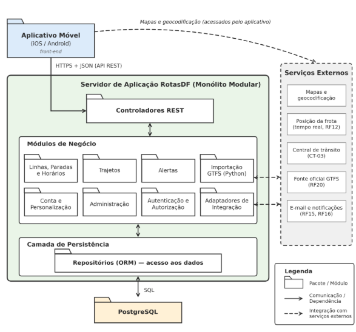
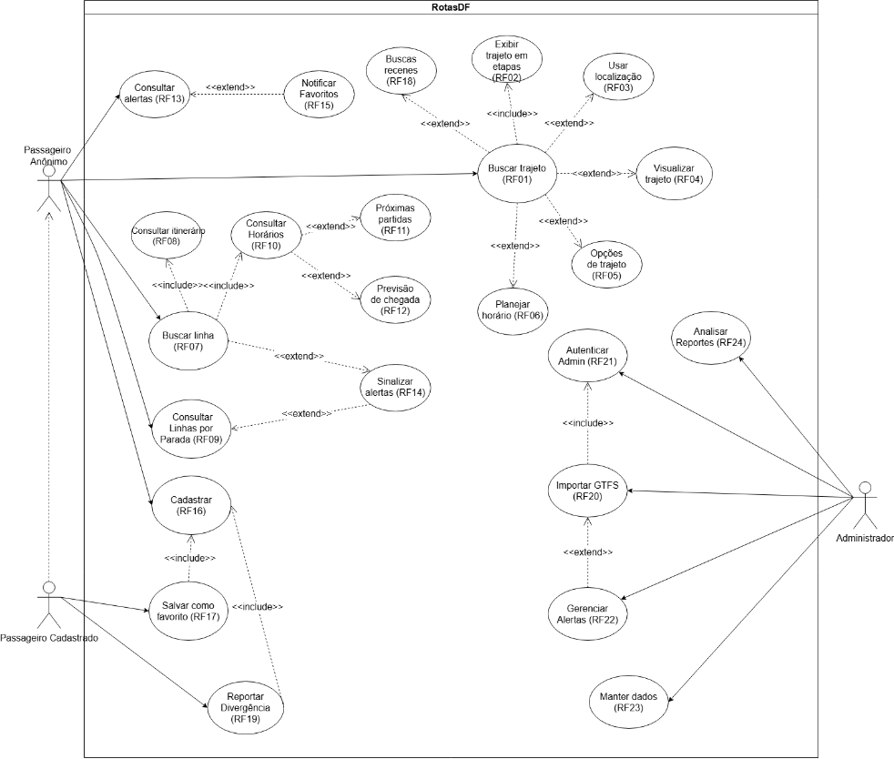
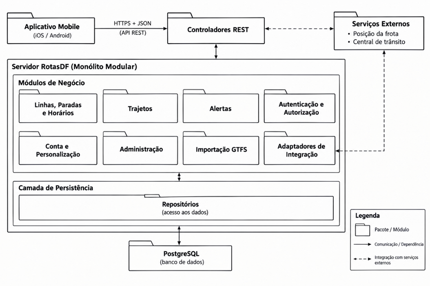
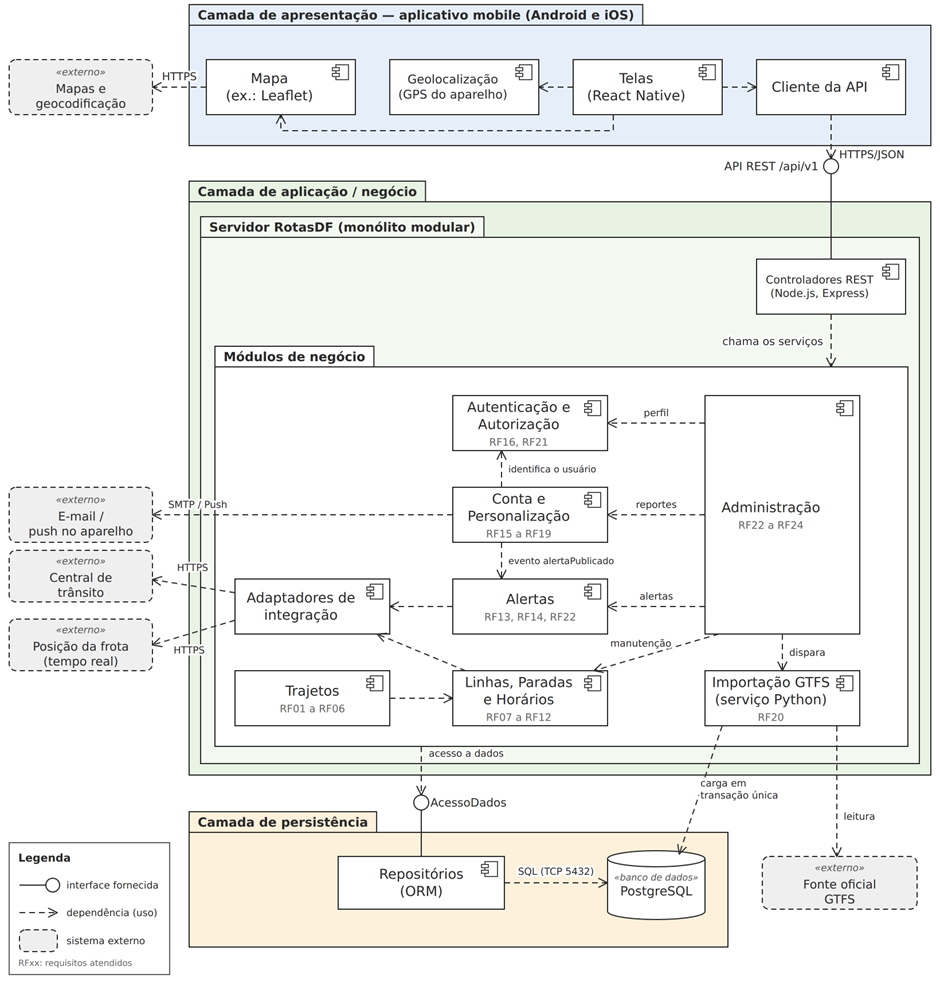
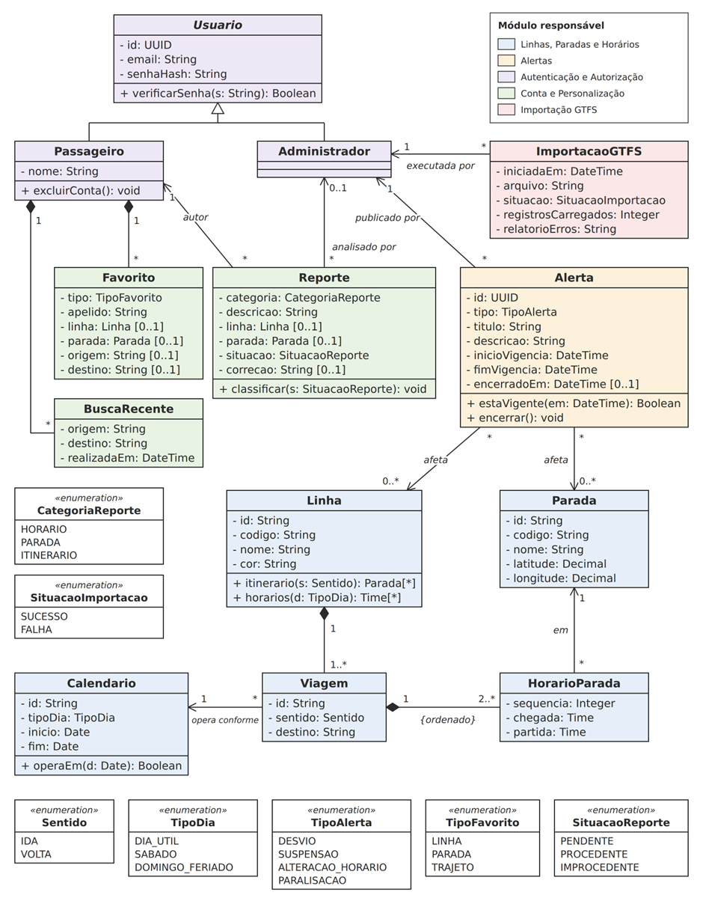
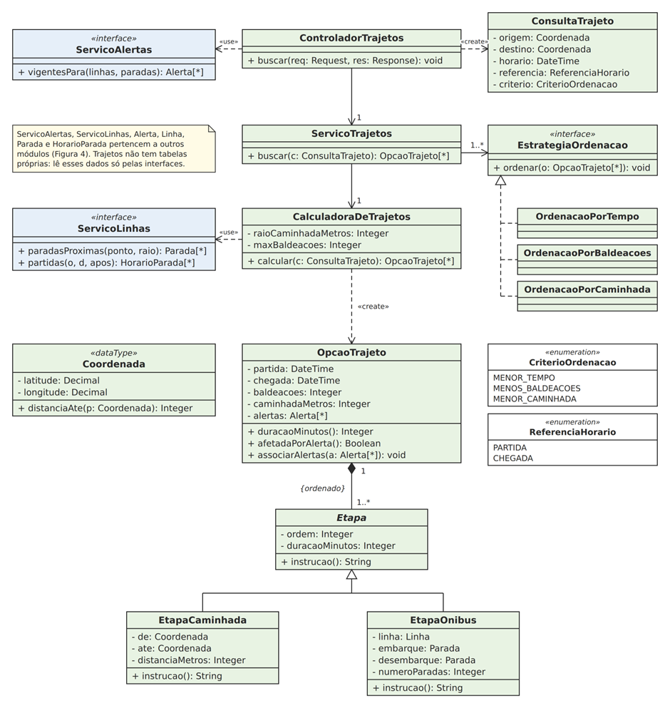
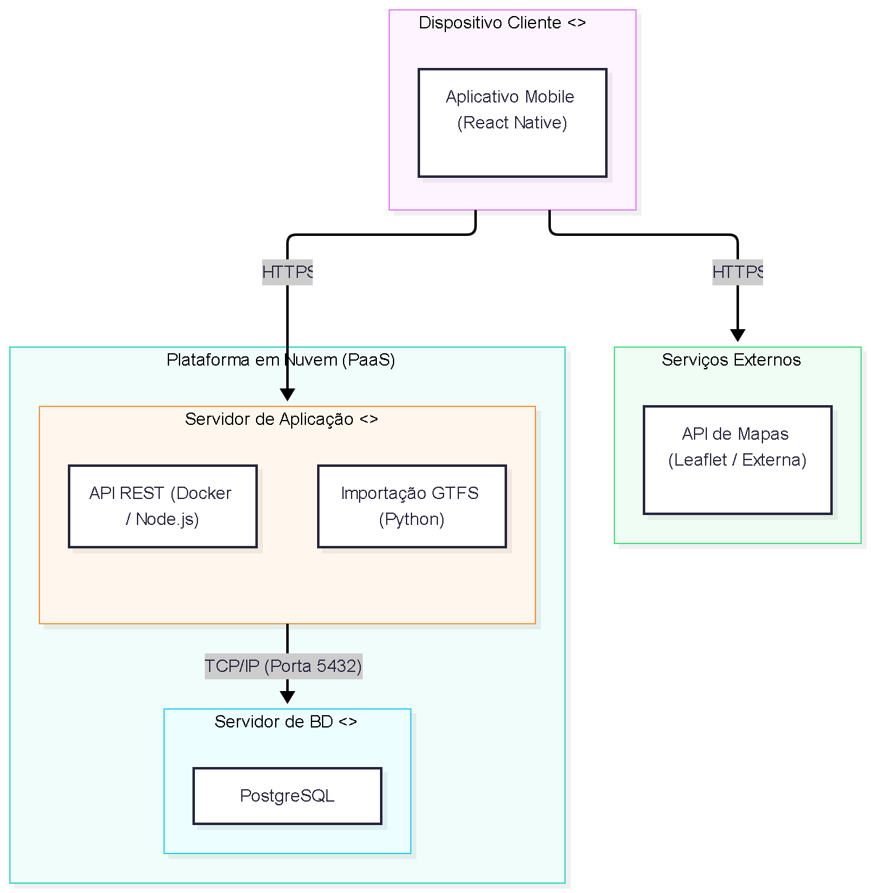

# RotasDF — Documento de Arquitetura

**Grupo Knuth (T02_KNUTH)** · Versão 1.1.0

## Integrantes do Grupo

| Matrícula | Nome | Função (responsabilidade) | Pontos de participação |
|---|---|---|---|
| 252014223 | Gabriel Sakai e Silva | Analista de qualidade / desenvolvedor | 16,6 |
| 242015601 | Emanuele Victor Santos | Scrum master / Líder do grupo / desenvolvedor | 16,6 |
| 232013990 | Gabriel Felix Mota Soares | Dono do produto / desenvolvedor | 16,6 |
| 190128160 | Guilherme Maciel de Meneses | Desenvolvedor | 16,6 |
| 222024819 | Gabriela Xavier Rodrigues | Desenvolvedor | 16,6 |
| 242015460 | Denilson Lima Santos | Desenvolvedor | 16,6 |

## Histórico de Revisões

| Data | Versão | Descrição | Autor(es) |
|---|---|---|---|
| 07/10/2026 | 1.0 | Versão inicial do Documento de Arquitetura | Todos |
| 27/10/2026 | 1.1.0 | Revisão do Sumário, correção da formatação ABNT em cabeçalhos e referências, e inserção do Diagrama de Implantação | Denilson Lima Santos |

## Sumário

1. [Introdução](#1-introdução)
   - [1.1 Propósito](#11-propósito)
   - [1.2 Escopo](#12-escopo)
2. [Representação arquitetural](#2-representação-arquitetural)
   - [2.1 Definições](#21-definições)
   - [2.2 Justificativa da escolha arquitetural](#22-justificativa-da-escolha-arquitetural)
   - [2.3 Detalhamento](#23-detalhamento)
   - [2.4 Metas e restrições arquiteturais](#24-metas-e-restrições-arquiteturais)
   - [2.5 Visões](#25-visões)
   - [2.6 Visão de implantação](#26-visão-de-implantação)
   - [2.7 Restrições adicionais](#27-restrições-adicionais)
3. [Referências](#3-referências)

---

## 1 Introdução

### 1.1 Propósito

Este documento descreve a arquitetura do sistema RotasDF, desenvolvido pelo grupo Knuth (T02_KNUTH) na disciplina de MDS — Métodos de Desenvolvimento de Software, edição do segundo semestre de 2026. Seu objetivo é fornecer uma visão abrangente do sistema para desenvolvedores, testadores e demais interessados nos aspectos relacionados às tecnologias usadas no desenvolvimento.

### 1.2 Escopo

O detalhamento do escopo encontra-se na Visão, versão 1.0.0, seção 4 (Declaração de Escopo do Projeto). Em linhas gerais, o produto compreende uma plataforma digital de transporte público que reúne, em uma interface responsiva e acessível:

- consulta de linhas, paradas, itinerários e quadros de horários;
- planejamento de trajetos entre origem e destino;
- divulgação de alertas de alteração no serviço;
- conta e personalização do passageiro (favoritos, buscas recentes e reporte de divergências);
- área administrativa para importação de dados oficiais (GTFS), gestão de alertas e manutenção da base.

O sistema atende a três perfis: Passageiro Anônimo, Passageiro Cadastrado e Administrador.

---

## 2 Representação arquitetural

### 2.1 Definições

O sistema seguirá uma arquitetura em três camadas (*three-tier*), com modelo cliente-servidor e comunicação por API REST:

1. **Front-end:** aplicativo mobile em React Native executado em dispositivos móveis (Android e iOS);
2. **Servidor de aplicação:** API REST em Node.js que concentra as regras de negócio, acompanhada do serviço de importação de dados GTFS em Python;
3. **Banco de dados relacional:** PostgreSQL.

O servidor de aplicação é organizado como um **monólito modular**: uma única aplicação implantável, dividida internamente em módulos coesos por funcionalidade.

- **Cliente-servidor:** o cliente (aplicativo mobile) solicita serviços e o servidor os executa e responde (SOMMERVILLE, 2019).
- **Três camadas:** apresentação (front-end), aplicação/negócio (servidor de aplicação) e persistência (banco de dados). Cada camada só se comunica com a vizinha (RICHARDS, 2015).
- **API REST:** única porta de entrada do servidor; o front-end nunca acessa o banco diretamente (FIELDING, 2000).
- **Monólito modular:** módulos de baixo acoplamento (linhas e horários, trajetos, alertas, conta, autenticação e administração) em uma única aplicação.

#### Regras de dependência

- O front-end só se comunica com o servidor de aplicação, pela API REST.
- Os módulos só acessam o banco pelos repositórios; nenhum módulo executa SQL diretamente nem conhece HTTP.
- Um módulo não acessa as tabelas de outro: usa o serviço do módulo correspondente.

**Tecnologias:** React Native no front-end mobile; Node.js e Python no servidor; PostgreSQL no banco de dados; Docker, GitHub e VS Code no processo e na infraestrutura.

### 2.2 Justificativa da escolha arquitetural

A escolha considera os seguintes pontos do Documento de Visão do Produto e do Projeto (doravante, Visão), incluindo a Declaração de Escopo (seção 4):

#### Fatores que orientaram a decisão

- **Perfis distintos de usuário (Visão, seção 4.2).** Passageiro Anônimo, Passageiro Cadastrado e Administrador acessam o mesmo conjunto de dados com permissões diferentes. Concentrar as regras de negócio e a autorização no servidor de aplicação evita que o controle de acesso fique espalhado pelo cliente.
- **Interface mobile responsiva e acessível (Visão, seções 1.2 e 4.1).** O diferencial do produto é a acessibilidade e a facilidade de uso em dispositivos móveis. Separar a apresentação (React Native) da lógica permite evoluir a interface mobile com rapidez, sem afetar as regras de negócio.
- **Entregas incrementais em Sprints semanais (Visão, seções 2.1 e 2.3).** Os módulos são entregues progressivamente, do módulo base (S1) aos recursos avançados (S5). Módulos independentes dentro de um único monólito permitem que cada Sprint entregue um incremento sem a sobrecarga operacional de vários serviços.
- **Equipe de 6 integrantes e prazo curto (26/10 a 29/11/2026).** O monólito modular reduz a complexidade de implantação e de integração em comparação a microsserviços e mantém baixo acoplamento entre os módulos, o que facilita uma eventual separação futura (RICHARDS, 2015).
- **Dados oficiais em formato padronizado (Visão, RF20).** Um serviço de importação isolado das consultas permite validar e carregar os dados GTFS sem afetar a experiência do passageiro.
- **Picos de acesso (Visão, seção 6.1).** A estratégia de testes prevê desempenho em horários de pico. Uma camada de aplicação única permite concentrar cache, paginação e controle de carga em um só lugar (MR01).
- **Práticas de XP e qualidade (Visão, seções 2.1, 3 e 5.1).** Camadas e módulos bem delimitados favorecem os testes unitários por módulo, os testes de integração entre camadas e a meta de 80% de cobertura (MR06).

#### Alternativas consideradas e descartadas

- **Microsserviços.** Cada módulo seria um serviço independente. Foi descartada porque exigiria comunicação entre serviços, monitoramento e implantação mais complexos, sem benefício proporcional para uma equipe de 6 pessoas e cinco semanas de desenvolvimento (SOMMERVILLE, 2019; RICHARDS, 2015). A organização em módulos permite migrar para essa abordagem no futuro, se necessário.
- **Aplicação web tradicional sem aplicativo mobile.** Foi descartada porque a interface mobile com mapa e navegação por geolocalização nativa, previstas na Visão (seção 1.4), exigem uma experiência nativa ou híbrida otimizada para smartphones (React Native). A API REST também permite reutilizar o back-end em outros clientes no futuro.
- **Back-end como serviço (BaaS) ou funções sem servidor.** Foi descartada porque o cálculo de trajetos e a importação e validação dos dados GTFS exigem lógica própria e controle sobre o banco relacional (PostgreSQL), já definido na Visão.

#### Consequências e riscos aceitos

- O monólito é implantado e escalado como um todo. Se um módulo exigir muito mais recursos, como o cálculo de trajetos, será necessário otimizá-lo por cache e índices antes de separá-lo.
- O uso de duas linguagens (Node.js e Python) aumenta o esforço de configuração. O risco é reduzido ao isolar o Python no serviço de importação e padronizar os ambientes com Docker (MR08).
- A disponibilidade de mapas, geocodificação e dados de transporte depende de serviços e fontes externas. Isso motiva a validação prévia dos dados e o tratamento de falhas (MR09).

### 2.3 Detalhamento

A figura a seguir apresenta o estilo arquitetural escolhido, com as camadas, os componentes principais, as interfaces e os conectores.

<b>Figura 1 — Arquitetura em três camadas do RotasDF</b>

#### Elementos e responsabilidades

**Camada de apresentação (front-end)**

- **Aplicativo Mobile (React Native):** exibe as telas de busca, trajetos, linhas, horários, alertas, conta e administração em dispositivos Android e iOS, consumindo a API REST.
- **Componente de Mapa:** desenha itinerários, paradas e trajetos na interface móvel (RF04, RF08).
- **Geolocalização (GPS nativo do dispositivo):** obtém a localização atual do usuário via sensores nativos do smartphone/tablet, mediante autorização (RF03).

**Camada de aplicação/negócio (servidor de aplicação)**

- **Controladores REST (Node.js, Express):** recebem as requisições HTTP, validam entradas, chamam os módulos e padronizam respostas e erros.
- **Linhas, Paradas e Horários:** consulta de linhas, itinerários, paradas, quadros de horários e próximas partidas (RF07 a RF12).
- **Trajetos:** cálculo de opções de trajeto, etapas, baldeações e tempo estimado, com ordenação e filtros (RF01 a RF06).
- **Alertas:** cadastro, consulta e encerramento de alertas, associados a linhas e paradas; expiração automática dos vencidos (RF13, RF14, RF22).
- **Autenticação e Autorização:** autentica administradores e passageiros e aplica permissões por perfil (RF16, RF21).
- **Conta e Personalização:** buscas recentes, favoritos, reporte de divergências e notificações de alterações em favoritos (RF15 a RF19).
- **Administração:** manutenção manual de linhas, paradas e horários e análise de reportes (RF23, RF24).
- **Serviço de Importação GTFS (Python):** lê, valida e carrega os dados oficiais na base (RF20).
- **Adaptadores de integração:** concentram a comunicação com serviços externos (posição da frota em tempo real e central de trânsito) e tratam falhas.

**Camada de persistência (banco de dados)**

- **Repositórios (ORM):** isolam o acesso ao banco.
- **Banco de dados (PostgreSQL):** persiste linhas, paradas, itinerários, horários, alertas, usuários, favoritos e reportes.

**Interfaces e conectores**

- **API REST (aplicativo mobile → controladores):** recebe requisições HTTPS com JSON/parâmetros e devolve JSON com código HTTP padronizado.
- **Chamada de módulo (controladores → módulos):** recebe objetos já validados e devolve o resultado da regra de negócio.
- **Acesso a dados (módulos → repositórios → PostgreSQL):** comandos de leitura e escrita via ORM.
- **Importação (fonte oficial GTFS → serviço de importação):** valida arquivos GTFS antes da persistência no banco.
- **Notificação (módulo Conta → e-mail / push no aplicativo mobile):** notificação enviada a usuários cadastrados sobre alterações nos favoritos (RF15).

### 2.4 Metas e restrições arquiteturais

Cada item abaixo traz a meta ou restrição e sua justificativa, com a seção da Visão de onde ela decorre. Quando o valor ou o mecanismo é decisão da equipe, e não consta na Visão, isso está indicado.

#### MR01 — Desempenho e capacidade

- **Meta:** 95% das consultas de linhas, horários e alertas respondidas em até 2 segundos, e a busca de trajeto em até 5 segundos, com até 500 usuários simultâneos em horários de pico. Cache e paginação são obrigatórios nas consultas frequentes.
- **Justificativa:** a Visão (seção 6.1) exige garantir estabilidade em horários de pico. O público busca informação rápida, e a demora reproduz o problema que o produto quer resolver.

#### MR02 — Responsividade e acessibilidade

- **Meta:** aplicativo mobile responsivo e adaptável a diferentes tamanhos de tela (Android e iOS), em conformidade com diretrizes de acessibilidade mobile (WCAG 2.1 nível AA / diretrizes de acessibilidade Android e iOS).
- **Justificativa:** a acessibilidade é o diferencial do produto (Visão, seções 1.2 e 4.1) e responde às causas "exclusão digital" e "barreiras sensoriais" do Diagrama de Ishikawa. A escolha pelo aplicativo mobile em React Native é da equipe para garantir boa experiência em dispositivos móveis.

#### MR03 — Padrão de API

- **Restrição:** API REST em JSON, com verbos e códigos HTTP adequados, prefixo `/api/v1`, formato único de erro e documentação em OpenAPI (FIELDING, 2000; OPENAPI INITIATIVE, 2021).
- **Justificativa:** um contrato único entre front-end e back-end reduz retrabalho e facilita os testes de integração previstos na Visão (seção 6.1).

#### MR04 — Padrão de codificação

- **Restrição:** ESLint e Prettier para JavaScript/React Native e PEP 8 para Python (VAN ROSSUM; WARSAW; COGHLAN, 2001), com Clean Code (MARTIN, 2009); funções curtas, nomes em camelCase (JavaScript) e snake_case (Python), um módulo por funcionalidade.
- **Justificativa:** a Visão (seções 2.1 e 3) exige Coding Standards e Clean Code, sem definir as ferramentas, que são escolha da equipe. As ferramentas rodam no pipeline de CI, e código fora do padrão não é integrado.

#### MR05 — Revisão por pares, integração contínua e branches

- **Restrição:** todo código entra pela `main` apenas por Pull Request revisado (Analista de Qualidade e outro desenvolvedor) e com o pipeline do GitHub Actions sem falhas. As branches são `feature/*`, `develop`, `staging` e `main`, sem commits diretos na `main`.
- **Justificativa:** é a Definição de Pronto e a política de branches da Visão (seções 3 e 6.1), e reduz defeitos antes das inspeções de repositório.

#### MR06 — Cobertura de testes

- **Meta:** cobertura mínima de 80% do código desenvolvido, medida ao final de cada Sprint pelo pipeline, principalmente nas regras de negócio.
- **Justificativa:** é o valor esperado da Métrica 2 do GQM (Visão, seção 5.1). A separação em camadas permite testar as regras sem HTTP nem banco.

#### MR07 — Segurança e privacidade

- **Meta:** comunicação por HTTPS; senhas armazenadas apenas como hash (bcrypt); acesso por tokens com expiração e por perfil, validado no servidor; entradas validadas e consultas parametrizadas; segredos em variáveis de ambiente. A geolocalização só é usada com autorização do usuário e os dados pessoais seguem a LGPD (BRASIL, 2018): coleta mínima e exclusão de conta.
- **Justificativa:** a Visão define os três perfis (seção 4.2) e exige autorização para a localização (RF03), autenticação (RF16, RF21) e exclusão de conta (RF16); os mecanismos citados são escolha da equipe. O sistema trata dados pessoais, como e-mail e localização.

#### MR08 — Ambientes padronizados com Docker

- **Restrição:** servidor de aplicação e banco de dados executam em contêineres descritos em arquivos versionados (Dockerfile e Docker Compose) para suporte ao back-end da aplicação mobile nos ambientes de desenvolvimento, homologação e produção.
- **Justificativa:** a Visão (seções 1.4 e 2.1) prevê o Docker para padronizar os ambientes de desenvolvimento e implantação, o que reduz diferenças entre máquinas e facilita o pipeline.

#### MR09 — Dados oficiais validados e tolerância a falhas externas

- **Restrição:** os dados de transporte são importados de fonte oficial em formato GTFS e validados antes de atualizar a base (GTFS, 2026); se a validação falhar, a base não é alterada. Falhas de serviços externos passam pelos adaptadores de integração e não podem tornar o sistema indisponível: o sistema segue com os dados programados e avisa o usuário.
- **Justificativa:** a Visão prevê a importação com validação (RF20), classifica como alto o risco de falhas na integração ou obtenção dos dados (seção 2.5). Dados incorretos ou indisponíveis reproduzem a causa "baixa confiabilidade" do Ishikawa.

#### MR10 — Tecnologias e prazo

- **Restrição:** GitHub, VS Code, Python, Node.js, React Native, PostgreSQL e Docker; entrega em cinco Sprints semanais, de 26/10 a 29/11/2026, com ponto de controle, inspeção e apresentação final. A Visão lista Python e Node.js sem dividir suas funções; a equipe decidiu usar Node.js na API, React Native no aplicativo mobile e Python na importação. Mudanças são avaliadas pelos critérios de replanejamento (Visão, seção 2.5) e registradas no histórico de revisões.
- **Justificativa:** tecnologias (seção 1.4) e cronograma (seções 2.3 e 3) já estão definidos na Visão; o monólito modular permite entregar um módulo por Sprint e reduz o risco de chegar às inspeções sem versão funcional.

### 2.5 Visões

A arquitetura do RotasDF é formada por meio de três visões: a **visão de uso**, que descreve o sistema sob a perspectiva do usuário final; a **visão de organização lógica**, que define a organização lógica do software em três camadas; e a **visão estrutural**, que detalha os componentes de software e seus conectores.

#### 2.5.1 Visão de uso

O RotasDF é uma plataforma digital que visa mitigar a desinformação no transporte público. O sistema reúne, em uma interface acessível, a consulta de linhas e horários, o planejamento de trajetos e a emissão de alertas de alteração em tempo real. O escopo abrange três perfis de acesso (Passageiro Anônimo, Passageiro Cadastrado e Administrador), sendo que a gestão de dados oficiais (GTFS) é de responsabilidade exclusiva do Administrador.

Os atores do sistema são:

- **Passageiro Anônimo:** pode consultar rotas, horários, mapas e trajetos livremente.
- **Passageiro Cadastrado:** possui login e senha. Além das permissões do anônimo, pode salvar rotas favoritas, registrar histórico de buscas, gerenciar preferências e reportar divergências.
- **Administrador:** importar dados GTFS, gerenciar alertas, analisar reportes, manter dados manualmente.

A Figura 2 apresenta a descrição resumida de cada caso de uso mapeado no sistema RotasDF, organizados por módulo funcional, conforme os requisitos estabelecidos no Backlog do Produto.

<b>Figura 2: Diagrama de caso de uso</b>

#### 2.5.2 Visão de organização lógica

A visão de organização lógica apresenta a decomposição do RotasDF em módulos coesos, definidos de acordo com as principais responsabilidades funcionais do sistema. Essa organização é compatível com a arquitetura em três camadas e com o modelo de monólito modular definido nas seções anteriores. Dessa forma, os módulos permanecem integrados em uma única aplicação de servidor, mas possuem responsabilidades bem delimitadas e baixo acoplamento.

A organização lógica foi definida considerando os cenários funcionais e os requisitos apresentados na Declaração de Escopo do projeto.

##### Módulo de Linhas, Paradas e Horários

Este módulo é responsável pelas funcionalidades relacionadas à consulta e à organização das informações básicas do transporte público. Ele disponibiliza dados sobre linhas, itinerários, paradas, horários e próximas partidas.

Sua responsabilidade está relacionada principalmente aos requisitos RF07 a RF12 e ao cenário C2 — Consulta de linhas e paradas, além de parte do cenário C3 — Consulta de horários. O módulo recebe solicitações dos controladores REST, aplica as regras de negócio correspondentes e utiliza os repositórios para consultar os dados persistidos no PostgreSQL.

O módulo não acessa diretamente outros módulos nem o banco de dados. Quando necessita de informações persistidas, utiliza sua camada de repositórios, mantendo o acesso aos dados isolado da lógica de negócio.

##### Módulo de Trajetos

O módulo de Trajetos concentra as regras responsáveis pelo planejamento de deslocamentos entre uma origem e um destino. Ele calcula as opções disponíveis, organiza o percurso em etapas, identifica baldeações e calcula o tempo total estimado, além de permitir a aplicação dos critérios de ordenação e filtragem definidos para o sistema.

Está diretamente relacionado ao cenário C1 — Planejamento de trajetos e aos requisitos RF01 a RF06. Também utiliza informações de linhas, paradas e horários para construir as opções de deslocamento.

A comunicação com os demais componentes ocorre por meio das chamadas internas entre módulos, realizadas pelo servidor de aplicação. O módulo de Trajetos não conhece HTTP nem acessa diretamente o banco de dados, recebendo dados previamente validados pelos controladores e utilizando os repositórios para persistência quando necessário.

##### Módulo de Alertas

O módulo de Alertas é responsável pelo cadastro, consulta, atualização e encerramento dos alertas relacionados a alterações no serviço de transporte público. Também controla a vigência dos alertas e sua associação a linhas e paradas, incluindo a retirada automática de alertas vencidos.

Esse módulo atende principalmente aos requisitos RF13, RF14 e RF22 e está associado ao cenário C4 — Alterações no serviço.

Os alertas podem ser consultados pelo passageiro por meio da API REST, enquanto as operações de cadastro e gerenciamento dependem da autorização do perfil Administrador. O módulo também fornece informações utilizadas pelo módulo de Conta e Personalização para identificar alterações que afetam linhas ou paradas favoritas.

##### Módulo de Autenticação e Autorização

Este módulo concentra as regras relacionadas à identificação dos usuários e ao controle de permissões de acesso. É responsável pela autenticação de passageiros e administradores e pela aplicação das permissões correspondentes a cada perfil.

O módulo está relacionado aos requisitos RF16 e RF21 e aos perfis Passageiro Cadastrado e Administrador definidos na Visão do Produto.

A autenticação ocorre por meio da API REST, enquanto a autorização é aplicada no servidor antes da execução das operações protegidas. Dessa forma, o cliente não é responsável por garantir as permissões de acesso. As credenciais e os tokens são tratados de acordo com as restrições de segurança definidas na arquitetura.

##### Módulo de Conta e Personalização

O módulo de Conta e Personalização concentra as funcionalidades específicas do Passageiro Cadastrado. Ele gerencia favoritos, buscas recentes, reportes de divergências e notificações relacionadas a alterações que afetem itens salvos pelo usuário.

Está relacionado aos requisitos RF15 a RF19 e ao cenário C5 — Conta e personalização do passageiro.

Esse módulo depende do módulo de Autenticação e Autorização para identificar o usuário e verificar suas permissões. Também se comunica com o módulo de Alertas para identificar alterações relacionadas às linhas e paradas favoritas. As informações específicas do usuário são persistidas por meio dos repositórios correspondentes.

##### Módulo de Administração

O módulo de Administração reúne as operações destinadas ao gerenciamento da base de dados de transporte e à análise dos reportes enviados pelos passageiros.

Suas principais responsabilidades são a manutenção manual de linhas, paradas, itinerários e horários, o gerenciamento dos alertas e a análise dos reportes recebidos. Está relacionado aos requisitos RF22, RF23 e RF24 e ao cenário C6 — Gestão dos dados de transporte.

O acesso a esse módulo é restrito ao perfil Administrador. Para realizar suas operações, o módulo utiliza os serviços de Autenticação e Autorização e os repositórios responsáveis pela persistência das informações.

##### Módulo de Importação GTFS

O módulo de Importação GTFS é responsável por receber, validar e carregar na base os dados oficiais de transporte público disponibilizados no formato GTFS.

A importação é executada exclusivamente pelo Administrador e está relacionada ao requisito RF20. Antes da atualização da base, os dados recebidos são validados. Caso sejam identificados erros, a atualização não deve ser realizada, preservando a integridade dos dados já existentes.

Esse módulo é implementado como um serviço específico em Python, enquanto a API principal do sistema é implementada em Node.js. A separação lógica permite que o processamento e a validação dos arquivos GTFS ocorram sem misturar essa responsabilidade às operações de consulta realizadas pelos passageiros.

##### Módulo de Adaptadores de Integração

O módulo de Adaptadores de Integração concentra a comunicação do sistema com serviços externos utilizados pelo RotasDF, como serviços relacionados à posição da frota em tempo real e à central de trânsito.

Os adaptadores têm como responsabilidade isolar as particularidades das APIs externas e tratar situações de indisponibilidade, erros e tempo limite. Dessa maneira, a dependência de serviços externos não é propagada diretamente para os demais módulos do sistema.

Quando uma informação externa não estiver disponível, o sistema deve continuar utilizando os dados programados disponíveis, conforme as regras de tolerância a falhas definidas na arquitetura.

##### Comunicação entre os módulos

A comunicação entre os componentes segue as regras de dependência estabelecidas na arquitetura. O aplicativo mobile não acessa diretamente os módulos internos ou o banco de dados: suas solicitações são encaminhadas aos Controladores REST, que validam as entradas e direcionam as operações ao módulo responsável.

A comunicação entre os controladores e os módulos ocorre por meio de chamadas internas, utilizando objetos previamente validados. Os módulos não conhecem HTTP e não dependem diretamente da camada de apresentação.

Quando um módulo necessita persistir ou consultar informações, utiliza seus respectivos Repositórios, que fazem a comunicação com o PostgreSQL. Dessa forma, o acesso ao banco permanece isolado da lógica de negócio.

As principais relações lógicas são:

- **Aplicativo Mobile → Controladores REST:** comunicação por API REST, utilizando HTTPS e JSON;
- **Controladores REST → Módulos de negócio:** chamadas internas com dados previamente validados;
- **Trajetos → Linhas, Paradas e Horários:** utilização das informações necessárias para cálculo e composição dos trajetos;
- **Conta e Personalização → Autenticação e Autorização:** identificação do usuário e validação de permissões;
- **Conta e Personalização → Alertas:** identificação de alterações que afetam itens favoritos;
- **Administração → Autenticação e Autorização:** validação do perfil de Administrador;
- **Módulos de negócio → Repositórios:** acesso às informações persistidas;
- **Repositórios → PostgreSQL:** operações de leitura e escrita;
- **Administração → Importação GTFS:** acionamento das operações de importação por usuário autorizado;
- **Módulos que necessitam de informações externas → Adaptadores de Integração:** acesso controlado aos serviços externos.

##### Diagrama de pacotes

O diagrama de pacotes apresentado representa a organização lógica dos principais módulos do RotasDF e suas dependências. As setas representam a direção da comunicação entre os componentes, enquanto a separação entre os pacotes evidencia a divisão das responsabilidades.

<b>Figura 3 — Diagrama de pacotes do RotasDF</b>

<i>Fonte: Elaborado pelos autores (2026).</i>

#### 2.5.3 Visão estrutural

A visão estrutural descreve como o RotasDF é composto e como suas partes se relacionam. Ela detalha os elementos da Figura 1 e os módulos da seção 2.5.2 em dois níveis, com a notação da UML 2.5 (OBJECT MANAGEMENT GROUP, 2017): o diagrama de componentes mostra as unidades de software, as interfaces que cada uma fornece e as dependências entre elas; os diagramas de classes mostram as entidades do domínio e a organização interna de um módulo.

##### Diagrama de componentes

A Figura 4 organiza os componentes nas três camadas da arquitetura. Os oito módulos de negócio são os mesmos do diagrama de pacotes. A Importação GTFS aparece entre eles por ser um módulo lógico do sistema, mas é executada como um serviço Python, em processo separado do servidor Node.js. O círculo indica uma interface fornecida, e a seta tracejada parte do componente que usa em direção ao componente ou à interface usada. Para manter a figura legível, as dependências entre módulos aparecem como setas diretas; cada uma corresponde ao uso da interface de serviço do módulo de destino, listada no Quadro 1.

<b>Figura 4 — Diagrama de componentes do RotasDF</b>

<i>Fonte: Elaborado pelos autores (2026).</i>

O Quadro 1 resume a responsabilidade de cada componente e as interfaces que ele fornece e usa.

**Quadro 1 — Componentes, responsabilidades e interfaces**

| Componente | Responsabilidade | Interface fornecida | Usa |
|---|---|---|---|
| **Camada de apresentação (aplicativo mobile)** | | | |
| Telas (React Native) | Telas de busca, trajetos, linhas, horários, alertas, conta e administração para Android e iOS, com acessibilidade (MR02). | — | Mapa; Geolocalização; Cliente da API |
| Mapa (ex.: Leaflet) | Desenha itinerários, paradas e trajetos (RF04, RF08). | — | Serviço externo de mapas e geocodificação |
| Geolocalização | Obtém a posição atual pelo GPS do aparelho, com autorização do usuário (RF03). | — | GPS do aparelho (sistema operacional) |
| Cliente da API | Centraliza as chamadas HTTP, envia o token e trata o formato único de erro. | — | API REST `/api/v1` |
| **Camada de aplicação / negócio** | | | |
| Controladores REST (Node.js, Express) | Recebem as requisições, validam as entradas, chamam os módulos e padronizam respostas e erros (MR03). | API REST `/api/v1` | Interfaces dos módulos |
| Linhas, Paradas e Horários | Consulta de linhas, itinerários, paradas, horários e próximas partidas (RF07 a RF12); operações de escrita usadas na manutenção manual (RF23). | ServicoLinhas | ProvedorPosicaoFrota; AcessoDados |
| Trajetos | Cálculo, detalhamento e ordenação das opções de trajeto (RF01 a RF06). | ServicoTrajetos | ServicoLinhas |
| Alertas | Cadastro, consulta, encerramento e expiração de alertas; emite o evento `alertaPublicado` (RF13, RF14, RF22). | ServicoAlertas | ProvedorCentralTransito; AcessoDados |
| Autenticação e Autorização | Cadastro e login de passageiros e administradores, emissão e validação de tokens e permissões por perfil (RF16, RF21, MR07). | ServicoAutenticacao | AcessoDados |
| Conta e Personalização | Favoritos, buscas recentes, reportes de divergência e notificações (RF15 a RF19). | ServicoConta | ServicoAutenticacao; ServicoAlertas (evento); e-mail / push; AcessoDados |
| Administração | Gestão de alertas, manutenção manual da base, análise de reportes e disparo da importação (RF22 a RF24). | ServicoAdministracao | ServicoAutenticacao; ServicoLinhas; ServicoAlertas; ServicoConta; ServicoImportacao |
| Importação GTFS (Python) | Lê o pacote GTFS, valida estrutura e consistência e carrega a base em transação única, em processo separado do servidor (RF20, MR09). | ServicoImportacao | Fonte oficial GTFS; PostgreSQL |
| Adaptadores de integração | Comunicação com a posição da frota e a central de trânsito, com tempo limite e tratamento de falhas (MR09). | ProvedorPosicaoFrota; ProvedorCentralTransito | Serviços externos (HTTPS) |
| **Camada de persistência** | | | |
| Repositórios (ORM) | Isolam o acesso ao banco; cada módulo usa só os repositórios das suas tabelas. | AcessoDados | PostgreSQL (SQL, porta 5432) |
| PostgreSQL | Armazena dados de transporte, alertas, usuários, favoritos, buscas, reportes e o histórico de importações. | Conexão SQL (porta 5432) | — |

*Fonte: Elaborado pelos autores (2026).*

As conexões entre os componentes seguem as regras de dependência da seção 2.1 e as relações lógicas da seção 2.5.2:

- **Entrada única pela API.** O aplicativo mobile só chega ao servidor pela API REST `/api/v1`, por HTTPS e em JSON (MR03). Os controladores validam as entradas e encaminham cada operação ao módulo responsável.
- **Identificação e perfil.** Conta e Personalização e Administração usam `ServicoAutenticacao` para identificar o usuário e verificar o perfil antes de executar operações protegidas (MR07).
- **Dependências em um só sentido.** Trajetos depende de Linhas, Paradas e Horários; Conta e Personalização depende de Alertas; Administração depende de Linhas, Paradas e Horários, Alertas, Conta e Personalização e Importação GTFS; Linhas, Paradas e Horários e Alertas dependem dos Adaptadores de integração. Não há ciclos, o que permite testar cada módulo com as dependências simuladas (MR06).
- **Administração sem acesso a tabelas de outros módulos.** A gestão de alertas (RF22), a manutenção manual da base (RF23) e a análise de reportes (RF24) são feitas pelos serviços dos módulos donos desses dados, e não pelos repositórios deles, conforme a regra da seção 2.1.
- **Notificação por evento.** Ao publicar um alerta, o módulo Alertas emite o evento interno `alertaPublicado`; Conta e Personalização o escuta, identifica os passageiros com favoritos afetados e envia a notificação por e-mail ou push no aparelho (RF15). Assim, Alertas não precisa conhecer Conta, e a dependência continua em um só sentido.
- **Serviços externos isolados.** As consultas à posição da frota e à central de trânsito passam pelos Adaptadores de integração, que aplicam tempo limite e tratam falhas. Se um serviço não responder, o sistema segue com os dados programados e avisa o usuário (MR09; Visão, caso CT-03).
- **Importação em processo separado.** Administração dispara a importação pela interface `ServicoImportacao`, e o serviço Python a executa em segundo plano. Como os repositórios do servidor são escritos em Node.js, a Importação GTFS tem acesso a dados próprio: lê o pacote GTFS, valida estrutura e consistência e grava os dados em uma única transação. Se a validação encontrar erros, a base não é alterada, e o resultado fica registrado no histórico de importações (RF20, MR09).
- **Acesso a dados só pelos repositórios.** No servidor, apenas os repositórios executam SQL no PostgreSQL, e cada módulo usa somente os repositórios das tabelas que lhe pertencem (Figura 4).

##### Diagramas de classes

O diagrama de classes foi dividido em duas figuras para manter a legibilidade. A Figura 5 mostra o modelo de domínio, isto é, as classes persistidas no banco de dados; a cor de cada classe indica o módulo responsável por ela. A Figura 6 detalha a estrutura interna do módulo Trajetos.

<b>Figura 5 — Diagrama de classes do domínio</b>

<i>Fonte: Elaborado pelos autores (2026).</i>

Os principais pontos do modelo de domínio são:

- **Dados de transporte.** As classes seguem a estrutura do GTFS: Linha corresponde a *routes*, Viagem a *trips*, Parada a *stops*, HorarioParada a *stop_times* e Calendario a *calendar*. Uma linha é composta por viagens; cada viagem opera conforme um calendário e percorre uma sequência ordenada de horários, cada um em uma parada. O itinerário (RF08) é a sequência de paradas de uma viagem em cada sentido, e o quadro de horários (RF10) reúne as partidas das viagens de acordo com o tipo de dia.
- **Alertas.** Um alerta afeta zero ou mais linhas e paradas e é publicado por um administrador (RF13, RF14, RF22). O método `estaVigente()` considera o período de vigência e o encerramento manual, o que permite deixar de exibir alertas vencidos sem intervenção.
- **Usuários e perfis.** Usuario é abstrata e se especializa em Passageiro e Administrador, que correspondem aos perfis Passageiro Cadastrado e Administrador. O Passageiro Anônimo não é persistido: corresponde às requisições feitas sem token. A senha é guardada só como hash (MR07), e `excluirConta()` atende à exclusão de conta prevista na LGPD (RF16).
- **Conta e personalização.** Favoritos e buscas recentes compõem o passageiro e são excluídos com a conta (RF17, RF18). Reporte registra a divergência enviada pelo passageiro (RF19) e a classificação feita pelo administrador (RF24).
- **Histórico de importações.** ImportacaoGTFS pertence ao módulo Importação GTFS e guarda cada execução, com o administrador que a disparou, a situação, o total de registros carregados e o relatório de erros (RF20).
- **Associações entre módulos.** As associações que cruzam módulos, como Alerta–Linha ou Reporte–Passageiro, são implementadas como chaves estrangeiras: o módulo que guarda a chave obtém os dados completos pela interface do outro módulo, e não pela tabela dele. Em Favorito e Reporte, as referências opcionais a Linha e Parada aparecem como atributos apenas para não sobrecarregar a figura.

<b>Figura 6 — Diagrama de classes do módulo Trajetos</b>

<i>Fonte: Elaborado pelos autores (2026).</i>

O módulo Trajetos foi detalhado por ser o mais complexo do sistema e por ilustrar a organização interna que todos os módulos seguem:

- **Camadas dentro do módulo.** `ControladorTrajetos` recebe a requisição HTTP, valida os parâmetros e monta uma `ConsultaTrajeto`; `ServicoTrajetos` coordena a busca e não conhece HTTP, o que permite testá-lo sem o servidor. Nos módulos que têm tabelas próprias, o serviço usa também os repositórios.
- **Sem tabelas próprias.** Trajetos não tem repositórios: as paradas e os horários vêm da interface `ServicoLinhas`, a única dependência do módulo (seção 2.5.2). O método `paradasProximas()` devolve as paradas dentro de um raio a partir de um ponto, e `partidas()` devolve os horários de saída da parada `o` com destino à parada `d` após o instante `apos`.
- **Sinalização de alertas.** Para marcar as opções afetadas por alterações no serviço (RF14), o controlador consulta `ServicoAlertas` e associa os alertas vigentes a cada `OpcaoTrajeto`. Como a chamada parte do controlador, que pode acionar qualquer módulo, Trajetos continua dependendo apenas de Linhas, Paradas e Horários.
- **Cálculo isolado.** `CalculadoraDeTrajetos` concentra o algoritmo de busca, limitado pelo raio de caminhada e pelo número máximo de baldeações. Esses parâmetros controlam o tempo de resposta (MR01), e a classe é o principal alvo dos testes unitários, com `ServicoLinhas` simulada (MR06).
- **Ordenação extensível.** A ordenação usa o padrão *Strategy* (GAMMA et al., 2000): cada critério do RF05 é uma classe que implementa `EstrategiaOrdenacao`, e o serviço escolhe a estratégia conforme o `CriterioOrdenacao` da consulta. Um novo critério exige apenas uma nova classe, sem alterar o serviço.
- **Instruções em linguagem simples.** Cada `OpcaoTrajeto` é composta por etapas ordenadas. `Etapa` é abstrata e se especializa em `EtapaCaminhada` e `EtapaOnibus`, que implementam `instrucao()` para gerar o texto exibido ao passageiro, como "Caminhe 300 m até a parada X" ou "Embarque na linha Y e desça após 6 paradas" (RF02).
- **Horário de partida ou de chegada.** `ReferenciaHorario` indica se o horário da consulta é de partida ou de chegada (RF06). `Coordenada` é um tipo de valor: o aplicativo converte endereços em coordenadas antes de chamar a API (seção 2.3).

### 2.6 Visão de implantação

A visão de implantação descreve o mapeamento dos artefatos de software para a infraestrutura de hardware e para os ambientes de execução (nós) nos quais o sistema operará, fundamentando-se nos conceitos e diretrizes arquiteturais adotados na disciplina.

O sistema RotasDF será implantado em um ambiente de computação em nuvem (*Cloud Computing*) utilizando contêineres Docker, o que garante a padronização dos ambientes de desenvolvimento, homologação e produção, conforme estabelecido na restrição MR08. A topologia física da aplicação está dividida da seguinte forma:

**Nó Cliente (`<<Device>>`):** representa o hardware do usuário final, abrangendo dispositivos móveis como smartphones e tablets.

- **Tecnologia:** sistemas operacionais mobile (Android e iOS).
- **Artefato:** aplicativo mobile (compilado via React Native).
- **Justificativa:** visando priorizar a acessibilidade, a mobilidade e a praticidade para o passageiro em trânsito, o aplicativo mobile garante integração nativa com os sensores do dispositivo (como o GPS) e proporciona um tempo de resposta otimizado.

**Nó Servidor de Aplicação (`<<Execution Environment>>`):** representa o servidor virtual em plataforma de nuvem (PaaS — ex.: Render, Heroku ou AWS) responsável pela hospedagem da lógica de negócio.

- **Tecnologia:** ambiente de execução Node.js conteinerizado via Docker. O serviço de importação de dados GTFS, desenvolvido em Python, será executado sob demanda no mesmo ambiente (ou via cron job/worker).
- **Artefato:** monólito modular da API REST.
- **Justificativa:** o uso de contêineres em uma plataforma gerenciada facilita as práticas de Integração e Entrega Contínuas (CI/CD) automatizadas pelo GitHub Actions (MR05). Essa abordagem permite que a equipe realize implantações contínuas de novos testes e funcionalidades sem a necessidade de gerenciar uma infraestrutura de baixo nível.

**Nó Servidor de Banco de Dados (`<<Database Server>>`):** representa o serviço de banco de dados relacional gerenciado.

- **Tecnologia:** Sistema Gerenciador de Banco de Dados PostgreSQL.
- **Artefato:** esquemas e tabelas de dados relacionais e georreferenciados.
- **Justificativa:** o PostgreSQL é uma solução robusta para manter a integridade transacional das informações de transporte e lidar com a estrutura complexa do formato GTFS. A eventual adoção da extensão PostGIS permite escalabilidade caso o sistema demande consultas espaciais mais complexas de geolocalização no futuro.

#### Diagrama de implantação

A representação visual ilustra a comunicação entre os nós físicos do sistema:

<b>Figura 7 — Diagrama de implantação do RotasDF</b>

- O Dispositivo Cliente comunica-se de forma segura com o Servidor de Aplicação por meio do protocolo HTTPS, consumindo a API REST.
- O Servidor de Aplicação conecta-se ao Servidor de Banco de Dados internamente via protocolo TCP/IP (Porta 5432) para operações de leitura e escrita.
- O Dispositivo Cliente também realiza requisições externas diretas (HTTPS) para a API de Mapas (ex.: provedores utilizados pelo Leaflet) para renderização cartográfica.

### 2.7 Restrições adicionais

O funcionamento e a arquitetura do RotasDF são guiados não apenas pelas tecnologias, mas por restrições negociais, características de qualidade e políticas rígidas de segurança.

#### 1. Aspectos negociais e de acesso

- **Acessibilidade pública:** o sistema é acessível diretamente pela Internet. Não é necessário estar em uma rede corporativa (Intranet).
- **Uso concomitante:** a aplicação deve estar preparada para suportar picos de acesso (estimativa de até 500 usuários simultâneos), especialmente em horários de pico do transporte público (início da manhã e fim da tarde). O cache de respostas e a paginação na API REST são obrigatórios para evitar sobrecarga no banco de dados nesses horários.

#### 2. Características de qualidade (baseadas na ISO/IEC 25010)

- **Usabilidade:** é a principal diretriz de qualidade do RotasDF. O sistema deve atender às diretrizes de acessibilidade WCAG 2.1 nível AA. Isso restringe o uso de componentes visuais que não sejam legíveis por leitores de tela e proíbe fluxos de navegação que dependam exclusivamente do mouse.
- **Portabilidade e compatibilidade:** o aplicativo mobile deve funcionar de maneira uniforme nos principais sistemas operacionais móveis (Android e iOS) em suas versões mais recentes.
- **Confiabilidade:** como o produto visa mitigar a desinformação no transporte público, a base de dados não pode ser editada livremente pelos usuários. A integridade dos itinerários é garantida pela validação dos pacotes oficiais GTFS antes da persistência.

#### 3. Segurança e perfis de usuário

Devido à natureza aberta do aplicativo, o acesso é segmentado por perfis, e a comunicação é estritamente protegida por criptografia de transporte (HTTPS/TLS) para evitar interceptação de dados de geolocalização e credenciais.

A autorização é baseada em tokens JWT (*JSON Web Token*), gerenciando os seguintes acessos:

- **Passageiro Anônimo:** possui permissão apenas de leitura. Pode consultar rotas, horários, mapas e trajetos livremente, sem necessidade de identificação. A localização (GPS) só é coletada mediante prompt de autorização explícita do sistema operacional mobile.
- **Passageiro Cadastrado:** exige login e senha (armazenada em hash via bcrypt). Além das permissões do perfil anônimo, possui acesso de escrita restrito à sua própria conta (salvar rotas favoritas, registrar histórico de buscas, gerenciar preferências e reportar divergências nos ônibus/paradas).
- **Administrador:** exige autenticação de alto nível (contas pré-cadastradas internamente). Possui permissão de escrita global para gerenciar alertas no sistema, aprovar/revisar reportes de passageiros e executar o módulo de importação e validação de dados GTFS. Não tem acesso às senhas cruas nem ao histórico exato de geolocalização de usuários específicos, respeitando as normativas da LGPD.

---

## 3 Referências

GAMMA, Erich et al. **Padrões de projeto**: soluções reutilizáveis de software orientado a objetos. Porto Alegre: Bookman, 2000.

KRUCHTEN, Philippe. The 4+1 View Model of Architecture. **IEEE Software**, v. 12, n. 6, p. 42-50, nov. 1995.

OBJECT MANAGEMENT GROUP. **OMG Unified Modeling Language (OMG UML)**: version 2.5.1. [S. l.]: OMG, 2017. Disponível em: <https://www.omg.org/spec/UML/2.5.1>. Acesso em: 8 out. 2026.

RICHARDS, Mark. **Software Architecture Patterns**. Sebastopol: O'Reilly Media, 2015.

SOMMERVILLE, Ian. **Engenharia de Software**. 10. ed. São Paulo: Pearson Education do Brasil, 2019.
