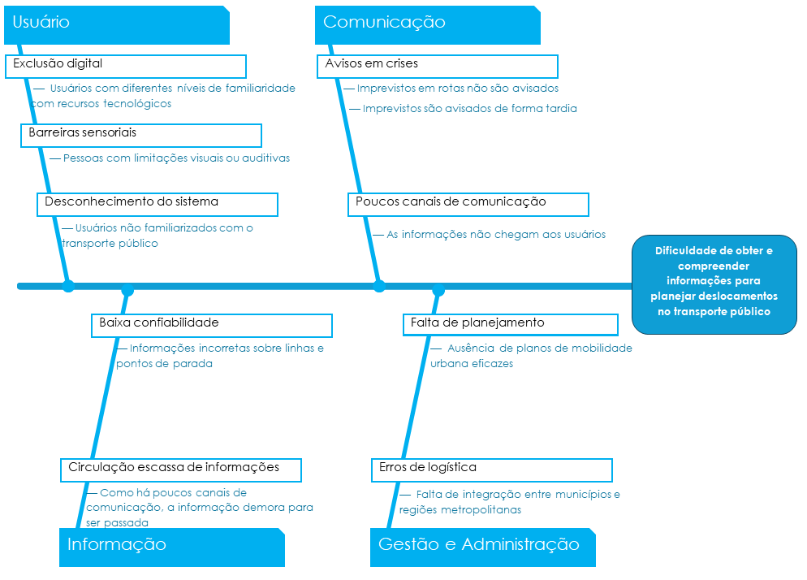

# RotasDF — Visão do Produto e do Projeto

**T02_KNUTH — RotasDF** · Versão 1.3.0

## Integrantes do Grupo

| Matrícula | Nome | Função (responsabilidade) | Pontos de participação |
|---|---|---|---|
| 252014223 | Gabriel Sakai e Silva | Analista de qualidade / desenvolvedor | 16,6 |
| 242015601 | Emanuele Victor Santos | Scrum Master / Líder do grupo / desenvolvedor | 16,6 |
| 232013990 | Gabriel Felix Mota Soares | Dono do produto | 16,6 |
| 190128160 | Guilherme Maciel de Meneses | Desenvolvedor | 16,6 |
| 222024819 | Gabriela Xavier Rodrigues | Desenvolvedor | 16,6 |
| 242015460 | Denilson Lima Santos | Desenvolvedor | 16,6 |
| | **Total de pontos** (devem fechar 100 para toda a equipe) | | **100** |

## Histórico de Revisões

| Data | Versão | Descrição | Autor |
|---|---|---|---|
| 30/09/2026 | 1.0.0 | Visão inicial do produto | Todos |
| 27/10/2026 | 1.1.0 | Alinhamento do modelo de branches e retirada do método TDD | Gabriel Sakai e Silva |
| 15/11/2026 | 1.2.0 | Reformula a parte de métricas e de teste além de atualizar a progressão do documento | Gabriel Sakai e Silva |
| 21/11/2026 | 1.3.0 | Inclui critérios de aceitação verificáveis para todas as 24 histórias do backlog (reparo do DEF-041) | Denilson Lima Santos |

## Sumário

1. [Visão geral do produto](#1-visão-geral-do-produto)
   - [1.1 Problema](#11-problema)
   - [1.2 Declaração de posição do produto](#12-declaração-de-posição-do-produto)
   - [1.3 Objetivos do produto](#13-objetivos-do-produto)
   - [1.4 Tecnologias a serem utilizadas](#14-tecnologias-a-serem-utilizadas)
2. [Visão geral do projeto](#2-visão-geral-do-projeto)
   - [2.1 Ciclo de vida do projeto](#21-ciclo-de-vida-do-projeto-de-desenvolvimento-de-software)
   - [2.2 Organização do projeto](#22-organização-do-projeto)
   - [2.3 Planejamento das fases/iterações](#23-planejamento-das-fases-eou-iterações-do-projeto)
   - [2.4 Matriz de comunicação](#24-matriz-de-comunicação)
   - [2.5 Gerenciamento de riscos](#25-gerenciamento-de-riscos)
3. [Processo de desenvolvimento de software](#3-processo-de-desenvolvimento-de-software)
4. [Declaração de escopo do projeto](#4-declaração-de-escopo-do-projeto)
   - [4.1 Backlog do produto](#41-backlog-do-produto)
   - [4.2 Perfis](#42-perfis)
   - [4.3 Cenários](#43-cenários)
   - [4.4 Tabela de backlog do produto](#44-tabela-de-backlog-do-produto)
5. [Métricas e medições](#5-métricas-e-medições)
6. [Testes de software](#6-testes-de-software)
7. [Referências bibliográficas](#7-referências-bibliográficas)

---

## 1 Visão geral do produto

### 1.1 Problema

O transporte público é um dos principais meios de locomoção da população urbana, sendo a base essencial para a mobilidade de grande parte das pessoas nas cidades. Ademais, além de garantir o direito de locomoção da população, o transporte público contribui para a inclusão social ao oferecer uma alternativa de deslocamento acessível para pessoas que não possuem veículo próprio.

No entanto, muitos usuários passam por dificuldades para obter e interpretar as informações necessárias para o planejamento de suas viagens devido a causas variáveis, conforme explicitado pela Figura 1.

<b>Figura 1: Diagrama de Ishikawa (Causa x Efeito)</b>

<i>Fonte: Elaborado pelos autores (2026)</i>

O Diagrama de Ishikawa (Causa x Efeito), apresentado na Figura 1, foi estruturado para mapear as raízes do problema central que o RotasDF se propõe a resolver: a dificuldade de obter e compreender informações para planejar deslocamentos no transporte público. Para uma análise aprofundada, as causas foram divididas em quatro grandes eixos: Usuário, Comunicação, Informação e Gestão e Administração. No eixo do Usuário, destacam-se a exclusão digital, que atinge pessoas com diferentes níveis de familiaridade tecnológica; as barreiras sensoriais de indivíduos com limitações visuais ou auditivas; e o desconhecimento do sistema por parte de passageiros não habituados com a dinâmica do transporte. No eixo de Comunicação, evidencia-se a falha na emissão de avisos durante crises, onde imprevistos em rotas não são comunicados ou o são de forma tardia, somado à existência de poucos canais de comunicação que impedem a informação de chegar de forma clara aos usuários.

No que tange ao eixo de Informação, o diagrama aponta a baixa confiabilidade como um fator crítico, gerado por informações incorretas sobre linhas e pontos de parada, além da circulação escassa de dados, onde a informação demora a ser disseminada. Por fim, o eixo de Gestão e Administração revela falhas estruturais, como a falta de planejamento em mobilidade urbana e os erros de logística decorrentes da falta de integração entre municípios e regiões metropolitanas. Diante desse cenário, o RotasDF posiciona-se como uma solução por meio de uma plataforma mobile, o produto combate a exclusão digital; mitiga a falha de comunicação ao centralizar avisos e alertas de alteração em tempo real; garante a confiabilidade da informação ao consumir dados oficiais e validados (GTFS); e auxilia na gestão de trajetos ao integrar as linhas e paradas de diferentes regiões em uma única interface.
 

### 1.2 Declaração de posição do produto

O produto irá se diferenciar por sua acessibilidade e facilidade de uso, permitindo que usuários com diferentes níveis de afinidade tecnológica tenham acesso rápido e intuitivo às informações. Dessa forma, o sistema busca promover a inclusão digital e facilitar o acesso a informações essenciais para o planejamento dos deslocamentos urbanos, conforme demonstrado na Tabela 1.

**Tabela 1: Especificações do produto**

| Item | Descrição |
|---|---|
| Para | Usuários de transporte público |
| Necessidade | Uma plataforma que ajude os usuários a planejarem suas viagens |
| Identificação do produto | É um aplicativo mobile, com o nome de "RotasDF" |
| Que | Disponibiliza informações confiáveis sobre linhas, horários e alterações nos serviços |
| Ao contrário | Escassez de informação transformando o transporte público mais imprevisível para os usuários |
| Nosso produto | Entrega informações acessíveis e de fácil entendimento |

O RotasDF tem como propósito central democratizar o acesso às informações do transporte público no Distrito Federal. Para isso, o produto disponibiliza uma interface mobile na qual o usuário pode consultar todas as linhas da região e visualizar seus itinerários completos. Além disso, a plataforma implementa um sistema de planejamento de viagens que captura a localização geográfica atual do usuário para definir a origem e solicita a inserção de um destino, a fim de calcular e sugerir as melhores rotas. Com essa abordagem, o sistema centraliza os dados de mobilidade urbana, mitigando a desinformação e facilitando o deslocamento.

*Fonte: Elaborado pelos autores (2026)*

### 1.3 Objetivos do produto

O produto busca reduzir as dificuldades enfrentadas pelos usuários de transporte público, disponibilizando dados sobre linhas, horários e alterações operacionais. Dessa maneira, o projeto contribui para um planejamento mais eficiente dos deslocamentos, reduzindo a imprevisibilidade do transporte público e melhorando a experiência dos usuários.

### 1.4 Tecnologias a serem utilizadas

Serão utilizadas as seguintes tecnologias:

- GitHub
- VS Code
- Python
- Node.js
- React
- HTML5
- CSS3
- PostgreSQL
- Docker

- **Gestão e versionamento:** Utiliza-se o **GitHub** para controle de versão distribuído. Como a equipe é composta por 6 pessoas trabalhando em paralelo, o GitHub garante a integridade do código e o acompanhamento transparente do fluxo de tarefas (via Kanban/GitHub Projects). Além disso, permite a revisão de código por pares através de Pull Requests, o que é essencial para manter a qualidade e evitar conflitos.

- **Ambiente e automação:** Utiliza-se o **Visual Studio Code** como ambiente integrado de desenvolvimento. O VS Code foi escolhido por ser leve, altamente customizável e possuir excelente integração nativa com Git e terminal.

- **Linguagens e frameworks (Back-end):** Utiliza-se **Python** e **Node.js**. O Python foi escolhido especificamente para a camada de importação de dados, pois suas bibliotecas são ótimas para ler, tratar e cruzar os arquivos massivos do governo (GTFS) e validar coordenadas geográficas. O Node.js foi adotado para a construção da API REST por ser rápido, lidar muito bem com requisições simultâneas e permitir que a equipe use JavaScript tanto no back-end quanto no front-end.

- **Linguagens e frameworks (Front-end):** Utiliza-se **React** (com React Native), **HTML5** e **CSS3**. O React Native permite criar o aplicativo mobile para Android e iOS a partir de uma única base de código, o que otimiza o tempo da equipe. Ele também possibilita o uso de APIs nativas e foca em acessibilidade. O HTML5 e CSS3 servem de base para a renderização web e para a documentação do projeto.

- **Banco de dados e containerização:** Utiliza-se o **PostgreSQL** e o **Docker**. O PostgreSQL é um banco de dados relacional extremamente robusto, essencial para suportar os milhões de registros de horários e itinerários gerados pelo GTFS, além de possuir funções matemáticas que permitem calcular a distância exata entre o GPS do usuário e as paradas. O Docker foi adotado para padronizar o ambiente; ele empacota o banco e a API em contêineres, garantindo que todos os 6 integrantes rodem o sistema com a mesma configuração.

---

## 2 Visão geral do projeto

### 2.1 Ciclo de vida do projeto de desenvolvimento de software

O tema do projeto é a plataforma de transporte público, com foco na melhoria da experiência dos usuários. O problema identificado consiste na dificuldade que esses usuários têm para obter e interpretar as informações necessárias ao planejamento de seus deslocamentos, como opções de trajetos, linhas, horários e alterações no serviço. Nesse contexto, o projeto busca responder à seguinte questão de pesquisa: **como facilitar o acesso e a compreensão das informações necessárias para que usuários do transporte público possam planejar seus deslocamentos?** Como solução, propõe-se uma plataforma que reúna a consulta de rotas, linhas, horários e alertas de alteração do serviço em uma interface responsiva.

Para a concepção e o desenvolvimento da plataforma, definiu-se um ciclo de vida de desenvolvimento de software ágil, estruturado com base em um modelo iterativo e incremental. A escolha por este modelo justifica-se pela necessidade de adaptação contínua diante da evolução dos requisitos, refinamento constante das funcionalidades de consulta de rotas e integração progressiva dos módulos do sistema.

A estrutura do ciclo de vida desdobra-se nos seguintes componentes formais:

**a) Metodologia:** adotou-se o paradigma do Desenvolvimento Ágil de Software. A escolha fundamenta-se nos valores do Manifesto Ágil, que priorizam software em funcionamento, colaboração constante entre os membros e capacidade de resposta a mudanças em detrimento do acompanhamento rígido de um plano inicial. No contexto de um sistema de transporte público, no qual regras de negócio, linhas e horários podem sofrer alterações, essa abordagem minimiza riscos de retrabalho e garante entregas de valor contínuas a cada iteração.

**b) Processo:** a estrutura e a gestão do trabalho são regidas pelo framework Scrum. O ciclo de desenvolvimento organiza-se em Sprints semanais no período de codificação, nas quais o escopo do projeto é fatiado em incrementos funcionais do produto. A equipe realiza os rituais formais do framework: *Sprint Planning* para seleção e estimativa de itens do Backlog, *Daily Meetings* para alinhamento diário e identificação de impedimentos, e *Sprint Review* acompanhada de *Retrospective* ao final de cada iteração para avaliação dos entregáveis e melhoria contínua do processo.

**c) Procedimentos (guia e modo de fazer):** a execução técnica orienta-se pelas práticas do Extreme Programming (XP). Estabeleceram-se diretrizes formais de codificação, integração contínua a cada alteração aprovada no repositório, refatoração constante para manutenção do código limpo e a obrigatoriedade de revisão por pares (*Code Review*) por meio de Pull Requests antes da incorporação de qualquer funcionalidade ao ramo principal (`main`).

**d) Métodos:** são aplicadas as seguintes técnicas estruturadas durante o desenvolvimento:

- **Testes unitários:** escrita de testes automatizados para validação das regras de negócio do sistema após a implementação do código funcional;
- **Programação em par (*Pair Programming*):** atuação conjunta de dois desenvolvedores na construção de módulos mais complexos para redução de defeitos e disseminação de conhecimento técnico na equipe;
- **Elicitação e modelagem de requisitos via User Stories:** especificação dos cenários funcionais e de uso no formato padronizado de Histórias de Usuário.

**e) Ferramentas (instrumentos para realização das tarefas):** a execução prática é suportada pelo seguinte ecossistema tecnológico:

- *Gestão e versionamento:* GitHub para controle de versão distribuído (Git) e GitHub Projects para acompanhamento transparente do fluxo de tarefas (A Fazer, Em Andamento, Em Revisão, Concluído);
- *Ambiente e automação:* Visual Studio Code (VS Code) como ambiente integrado de desenvolvimento (IDE) e GitHub Actions para automação do pipeline de Integração Contínua (CI/CD);
- *Linguagens e frameworks:* Python / Node.js para construção das APIs e regras de negócio no back-end, e React / HTML5 / CSS3 para o desenvolvimento da interface responsiva no front-end;
- *Banco de dados e containerização:* PostgreSQL para persistência e gestão dos dados de rotas, frotas e horários, e Docker para padronização dos ambientes de desenvolvimento e implantação.

Assim, a combinação entre entregas semanais, práticas de qualidade de código e validação frequente nas inspeções e pontos de controle da disciplina permite que as funcionalidades de consulta sejam refinadas a cada iteração, aproximando a solução da necessidade real dos usuários e respondendo à questão de pesquisa de forma incremental.

### 2.2 Organização do projeto

A estrutura organizacional da equipe foi planejada para promover a responsabilidade compartilhada e a colaboração contínua ao longo de todo o ciclo de vida do desenvolvimento do software. Visando evitar gargalos operacionais e garantir a aplicação das práticas ágeis do Scrum e do Extreme Programming (XP), os papéis e as responsabilidades foram distribuídos de forma transparente entre os integrantes do grupo, conforme detalhado na Tabela 2. Ressalta-se que essa divisão de atribuições não estabelece qualquer relação de hierarquia ou grau de importância: todos os integrantes são igualmente importantes e responsáveis pelo sucesso do projeto.

**Tabela 2: Divisão de papéis e responsabilidades da equipe do projeto**

| Papel | Atribuições | Responsável | Participantes |
|---|---|---|---|
| Desenvolvedor | Codificar o produto, codificar testes unitários, realizar refatoração | Todos os integrantes do grupo | Denilson, Emanuele, Gabriela, Gabriel Felix, Guilherme, Gabriel Sakai |
| Dono do Produto | Atualizar o escopo do produto, organizar o escopo das sprints, validar as entregas | Gabriel Felix | Gabriel Felix |
| Analista de Qualidade | Garantir a qualidade do produto, garantir o cumprimento do conceito de pronto, realizar inspeções de código | Gabriel Sakai | Gabriel Sakai, Gabriela |
| Cliente | Validar a usabilidade e fornecer feedbacks nas revisões de sprint | Professor e monitor da disciplina | Ricardo Ajax, Arthur |
| Scrum Master | Facilitar as cerimônias, garantir a aplicação das práticas ágeis, remover impedimentos | Emanuele | Emanuele |

*Fonte: Elaborado pelos autores (2026)*

### 2.3 Planejamento das fases e/ou iterações do projeto

O planejamento do projeto está organizado em cinco Sprints semanais, executadas de 26/10/2026 a 29/11/2026, período definido pelo cronograma da disciplina para o desenvolvimento do software. Cada Sprint está associada a um produto (entrega) e a entregáveis específicos, conforme apresentado na Tabela 3, e a distribuição das funcionalidades segue o Backlog do Produto (seção 4.4). Esse planejamento é atualizado de maneira sucessiva, a cada ciclo de desenvolvimento, com base nos resultados da Sprint Review e da Retrospective, de modo que datas, entregáveis e percentuais de conclusão reflitam sempre a situação real do projeto.

**Tabela 3: Planejamento das Sprints do projeto**

| Sprint | Produto (Entrega) | Início | Fim | Entregável(eis) | Responsáveis | 
|---|---|---|---|---|---|
| S1 | Módulo Base | 26/10/2026 | 01/11/2026 | Busca de linha por número ou nome; itinerário da linha; quadro de horários da linha; importação de dados de transporte | Equipe de Desenvolvimento e Analista de Qualidade | 
| S2 | Núcleo de trajetos | 02/11/2026 | 08/11/2026 | Busca de trajeto entre origem e destino; trajeto detalhado em etapas; localização atual como origem; linhas que atendem uma parada; buscas recentes | Equipe de Desenvolvimento e Dono do Produto |
| S3 | Alertas, Gestão Administrativa | 09/11/2026 | 15/11/2026 | Consulta de alertas vigentes; autenticação de administrador; cadastro e gestão de alertas; manutenção de linhas, paradas e horários; apresentação no ponto de controle | Equipe de Desenvolvimento e Analista de Qualidade |
| S4 | Inspeção de Software, Qualidade & Personalização | 16/11/2026 | 22/11/2026 | Sinalização de alertas nos itens afetados; cadastro e autenticação de passageiro; favoritos; reporte de divergências; análise de reportes; inspeção do repositório e início da correção dos defeitos; realização do teste funcional de sistema | Equipe de Desenvolvimento e Analista de Qualidade |
| S5 | Recursos Avançados, Refinamento & Entrega Final | 23/11/2026 | 29/11/2026 | Trajeto no mapa; comparação e ordenação de trajetos; planejamento por horário de partida ou chegada; próximas partidas em uma parada; previsão de chegada em tempo real; notificação de alterações em favoritos; correção dos defeitos restantes; versão final | Todos os papéis |

*Fonte: Elaborado pelos autores (2026)*

Como mostra a tabela 3, as Sprints foram estrategicamente alinhadas aos marcos do cronograma da disciplina. O ponto de controle ocorre no início da Sprint 3, momento em que o módulo base e o núcleo de trajetos (Sprints 1 e 2) já estão operacionais. O feedback recebidos neste ponto de controle serão tratados como prioridade máxima pela equipe; eles serão discutidos na Sprint 3 e corrigidos ao longo das iterações seguintes, garantindo que os ajustes de usabilidade e as correções de rotas sejam validados pelo Dono do Produto antes de avançar. Posteriormente, a inspeção dos repositórios ocorre no início da Sprint 4, etapa em que a equipe dedicará a semana para sanar os defeitos apontados pelos inspetores, assegurando uma versão estável e polida para a apresentação final.

### 2.4 Matriz de comunicação

A matriz de comunicação do RotasDF foi desenhada combinando ferramentas formais de alinhamento e canais ágeis de resolução de problemas. Para a governança e acompanhamento semanal, adotamos encontros síncronos via Microsoft Teams. Nessas reuniões, a equipe realiza o planejamento do que deve ser feito na sprint e revisar o que já foi feito. O objetivo é alinhar o andamento do projeto e garantir que todos tenham clareza das próximas tarefas.

De forma complementar e contínua, o grupo utiliza um canal no WhatsApp como ferramenta de comunicação rápida. Esse ambiente é focado na resolução de problemas técnicos do dia a dia e no bloqueio de impedimentos. É por meio dele que a equipe resolve dúvidas ágeis relacionadas ao Git e alinha a integração de código entre o Frontend e o Backend, garantindo que nenhum desenvolvedor fique travado por muito tempo.

A matriz de comunicação do RotasDF passará por uma atualização nas Sprints 4 e 5. A partir dessas etapas, todas as reuniões semanais contarão com o registro formal de atas de reunião. Essa melhoria tem como objetivo aprimorar o rastreamento das decisões tomadas pela equipe, além de garantir que todo o histórico de informações, alinhamentos e revisões do projeto fique devidamente documentado e acessível a todos os membros.

*Fonte: Elaborado pelos autores (2026)*

### 2.5 Gerenciamento de riscos

**Tabela 4: Riscos**

| Risco | Mitigação | Plano de contingência |
|---|---|---|
| Obtenção dos dados de transporte | Alto | Procura constante de dados pelo Analista de Qualidade  | Realizar possíveis mudanças nas sprints |
| Desenvolvedores com pouco  | Alto | Reuniões semanais | Realizar mais reuniões durante as sprints para manter a equipe engajada |
| Atraso na conclusão das atividades da sprint | Médio | Acompanhar as atividades durante a sprint e identificar impedimentos antecipadamente | Repriorizar atividades e transferir itens não concluídos para uma sprint posterior |

*Fonte: Elaborado pelos autores (2026)*

O gerenciamento de riscos do RotasDF foi estruturado para antecipar e mitigar os principais desafios que podem comprometer o cronograma do projeto. O primeiro risco mapeado é a obtenção dos dados de transporte. Para mitigar esse problema, o Analista de Qualidade realizará uma procura e validação constante das fontes de dados. Caso essa obtenção falhe, o escopo do projeto irá ser reduzido sem afetar as funcionalidades.

O segundo risco refere-se à possibilidade de desenvolvedores não saberem o que fazer na sprint. A estratégia de mitigação adotada são as reuniões semanais de alinhamento, que garantem que as tarefas e os objetivos estejam claros para todos. Se, durante a semana, a equipe apresentar dúvidas ou desalinhamento, o plano de contingência prevê a realização de reuniões extras para manter a equipe engajada e destravar o desenvolvimento.

Por fim, o terceiro risco é o atraso na conclusão das atividades da sprint. Para mitigar isso, a equipe acompanhará ativamente o andamento das tarefas e identificará impedimentos antecipadamente. Se o atraso for inevitável, o plano de contingência determina a repriorização das atividades, transferindo os itens não concluídos para uma sprint posterior, garantindo que o foco permaneça nas entregas mais críticas para a disciplina.

---

## 3 Processo de desenvolvimento de software

Esta seção registra, de forma objetiva e orientadora, as decisões da equipe quanto ao processo de desenvolvimento de software, com base no Scrum e no Extreme Programming (XP), em alinhamento com o ciclo de vida descrito na seção 2.1. Entende-se por processo um conjunto de atividades logicamente encadeadas, com início e fim, que consomem recursos, geram resultados e possuem papéis responsáveis.

No projeto, o desenvolvimento ocorre de 26/10/2026 a 29/11/2026, período definido pelo cronograma da disciplina, e é organizado em cinco Sprints semanais, iniciadas às segundas-feiras. Cada Sprint começa com o Backlog do Produto priorizado e termina com um incremento validado e entregue, utilizando como recursos o repositório no GitHub.

As atividades, com seus responsáveis e resultados, são:

- **a) Refinamento e priorização do Backlog:** o Dono do Produto prioriza as *User Stories*, gerando o Backlog do Produto priorizado;
- **b) Sprint Planning:** toda a equipe seleciona os itens que serão desenvolvidos;
- **c) Desenvolvimento:** a Equipe de Desenvolvimento codifica aplicando *Pair Programming* , gerando um incremento de código;
- **d) Reuniões semanais:** a equipe, facilitada pelo Scrum Master, alinha o andamento das tarefas e identifica impedimentos;
- **e) Pull Request e Code Review:** o Analista de Qualidade e os desenvolvedores revisam o código, que, uma vez aprovado, é integrado ao ramo developer;
- **f) Sprint Review:** a equipe revisa o que foi realizado na sprint;
- **g) Retrospective:** a equipe, facilitada pelo Scrum Master, define ações de melhoria para a próxima Sprint.

Além do fluxo interno de cada Sprint, o processo considera os marcos definidos no cronograma da disciplina:

- **a) Início do desenvolvimento (26/10/2026):** a equipe inicia de fato o desenvolvimento do software planejado;
- **b) Ponto de controle (09/11/2026 ou 11/11/2026):** a equipe apresenta o que foi desenvolvido até o momento, em 15 minutos, com presença obrigatória da turma;
- **c) Inspeção (16/11/2026):** equipes inspetoras avaliam os repositórios das equipes inspecionadas, e o professor divulga o resultado em 18/11/2026;
- **d) Correção de defeitos (a partir de 18/11/2026):** a equipe repara os defeitos apontados nas inspeções;
- **e) Apresentação do software em funcionamento (30/11/2026 ou 02/12/2026):** a equipe apresenta a versão final do produto.

Como os repositórios são inspecionados e auditados, os Pull Requests e o planejamento da seção 2.3 devem ser mantidos atualizados a cada Sprint.

Para garantir o alinhamento entre as etapas, a equipe adota um conceito de pronto (*Definition of Done*). Considera-se pronto o item do Backlog que atender cumulativamente aos seguintes critérios:

- a) testes unitários implementados;
- b) Código implementado;
- c) Revisão e merge via Pull Request na branch developer dentro do prazo da Sprint;

---

## 4 Declaração de escopo do projeto

O escopo do projeto da plataforma de transporte público visa atender à necessidade de facilitar o acesso e a compreensão das informações para o planejamento de deslocamentos. O escopo é detalhado por meio da identificação dos perfis de usuários, mapeamento de cenários funcionais e construção do backlog do produto.

### 4.1 Backlog do produto

O backlog do produto consiste na lista priorizada de todas as funcionalidades e requisitos técnicos necessários para a construção da plataforma. As funcionalidades foram priorizadas seguindo o método MoSCoW (*Must*, *Should*, *Could*) para alinhar as entregas de maior valor às Sprints do projeto.

- **Análise de documentos e padrões:** estudo do formato de dados GTFS (fonte oficial de transporte) e análise de soluções similares no mercado para embasar os requisitos de gestão de dados e alertas de serviço.
- **Criação de personas e histórias de usuário (User Stories):** utilizadas para mapear a jornada do "Passageiro" e do "Administrador", garantindo que os requisitos fossem escritos sob a ótica de quem utilizará o sistema.
- **Brainstorming com a equipe:** reuniões com os desenvolvedores para levantamento e definição dos requisitos não funcionais, como responsividade, acessibilidade e regras de manutenibilidade do código.

### 4.2 Perfis

**Tabela 5: Perfis de acesso**

| # | Nome do perfil | Características do perfil | Permissões de acesso |
|---|---|---|---|
| 1 | Passageiro Anônimo | Usuário comum que utiliza o transporte público e busca informações de forma rápida, sem desejo de criar vínculo formal | Acesso livre para buscar trajetos, consultar linhas, itinerários, horários e visualizar alertas de alterações no serviço |
| 2 | Passageiro Cadastrado | Usuário frequente que deseja personalizar sua experiência e manter um histórico de uso na plataforma (e-mail e senha) | Todas as permissões do Passageiro Anônimo, acrescidas de: criar conta, autenticar-se, salvar linhas/paradas favoritas, consultar buscas recentes e reportar divergências de informação |
| 3 | Administrador | Usuário interno responsável pela manutenção da base | Acesso restrito mediante login para importar dados de transporte (ex.: GTFS), cadastrar/gerenciar alertas de alteração, manter dados de linhas/horários e analisar os reportes enviados pelos passageiros |

*Fonte: Elaborado pelos autores (2026)*

### 4.3 Cenários

**Tabela 6: Cenários funcionais** — Sistema: Plataforma de Transporte Público

| Cenário | Nome do cenário | Sprints |
|---|---|---|
| C1 | Planejamento de trajetos | S2, S5 |
| C2 | Consulta de linhas e paradas | S1, S2 |
| C3 | Consulta de horários | S1, S5 |
| C4 | Alterações no serviço | S3, S4, S5 |
| C5 | Conta e personalização do passageiro | S2, S4 |
| C6 | Gestão dos dados de transporte (Administrador) | S1, S3, S4 |

*Fonte: Elaborado pelos autores (2026)*

### 4.4 Tabela de backlog do produto

Abaixo é apresentado o detalhamento dos requisitos funcionais (RF), vinculados aos seus cenários, Sprints estimadas e respectivas Histórias de Usuário (Tabela 7). Para tornar verificável a aprovação de cada entrega na estratégia de testes (seção 6.1) e na medição da Taxa de Conclusão de Histórias por Sprint (TCH), os critérios de aceitação operacionais de todas as 24 histórias (US01 a US24) estão detalhados na subseção 4.4.1 (Tabela 8); uma história só é considerada concluída quando todos os seus critérios de aceitação correspondentes são satisfeitos.

**Tabela 7: Backlog do produto** — Sistema: Plataforma de Transporte Público

#### C1 – Planejamento de trajetos

| Requisito | Sprint | Nome | Tipo | Prioridade | Descrição | User Story |
|---|---|---|---|---|---|---|
| C1 / RF01 | S2 | Buscar trajeto entre origem e destino | Funcional | Must | O sistema deve permitir que o usuário informe origem e destino (endereço, ponto de referência ou parada) e retornar as opções de trajeto disponíveis, com linhas, baldeações e tempo total estimado. | **US01** – Como passageiro, quero informar origem e destino para descobrir quais linhas e combinações me levam até onde preciso. |
| C1 / RF02 | S2 | Exibir trajeto detalhado em etapas | Funcional | Must | O sistema deve apresentar cada opção de trajeto em etapas sequenciais (caminhada até a parada, linha a embarcar, quantidade de paradas, ponto de desembarque e baldeações), em linguagem simples. | **US02** – Como passageiro, quero ver o trajeto dividido em etapas para saber exatamente onde embarcar, onde descer e onde trocar de linha. |
| C1 / RF03 | S2 | Usar localização atual como origem | Funcional | Should | O sistema deve permitir, mediante autorização do usuário, utilizar a localização do dispositivo como ponto de origem da busca. | **US03** – Como passageiro, quero usar minha localização atual como origem para não precisar digitar o endereço de onde estou. |
| C1 / RF04 | S5 | Visualizar trajeto no mapa | Funcional | Should | O sistema deve exibir o trajeto selecionado em um mapa, destacando o percurso de cada linha, as paradas de embarque e desembarque e os trechos a pé. | **US04** – Como passageiro, quero ver o trajeto desenhado no mapa para localizar com facilidade as paradas de embarque e desembarque. |
| C1 / RF05 | S5 | Comparar e ordenar opções de trajeto | Funcional | Should | O sistema deve permitir ordenar e filtrar as opções de trajeto por menor tempo total, menor número de baldeações e menor distância de caminhada. | **US05** – Como passageiro, quero ordenar as opções por tempo, baldeações ou caminhada para escolher a que melhor atende à minha necessidade. |
| C1 / RF06 | S5 | Planejar viagem por horário de partida ou chegada | Funcional | Could | O sistema deve permitir que o usuário defina o horário desejado de partida ou de chegada, considerando o quadro de horários das linhas no cálculo do trajeto. | **US06** – Como passageiro, quero informar o horário em que desejo sair ou chegar para planejar minhas viagens com antecedência. |

#### C2 – Consulta de linhas e paradas

| Requisito | Sprint | Nome | Tipo | Prioridade | Descrição | User Story |
|---|---|---|---|---|---|---|
| C2 / RF07 | S1 | Buscar linha por número ou nome | Funcional | Must | O sistema deve permitir buscar linhas pelo número ou pelo nome, com sugestões automáticas durante a digitação. | **US07** – Como passageiro, quero buscar uma linha pelo número ou pelo nome para acessar rapidamente suas informações. |
| C2 / RF08 | S1 | Consultar itinerário da linha | Funcional | Must | O sistema deve exibir o itinerário da linha, com a sequência de paradas em cada sentido, em formato de lista e de mapa. | **US08** – Como passageiro, quero ver as paradas da linha em cada sentido para confirmar se ela passa pelo local de que preciso. |
| C2 / RF09 | S2 | Consultar linhas que atendem uma parada | Funcional | Should | O sistema deve permitir selecionar uma parada, por busca ou pelo mapa, e listar todas as linhas que a atendem. | **US09** – Como passageiro, quero selecionar uma parada e ver quais linhas passam por ela para conhecer minhas opções a partir daquele ponto. |

#### C3 – Consulta de horários

| Requisito | Sprint | Nome | Tipo | Prioridade | Descrição | User Story |
|---|---|---|---|---|---|---|
| C3 / RF10 | S1 | Consultar quadro de horários da linha | Funcional | Must | O sistema deve exibir o quadro de horários da linha, separado por sentido e por tipo de dia (dias úteis, sábados, domingos e feriados). | **US10** – Como passageiro, quero consultar os horários da linha por sentido e tipo de dia para programar o momento da minha saída. |
| C3 / RF11 | S5 | Consultar próximas partidas em uma parada | Funcional | Should | O sistema deve exibir, para uma parada selecionada, os próximos horários programados de passagem de cada linha que a atende. | **US11** – Como passageiro, quero ver os próximos horários previstos em uma parada para saber quanto tempo vou esperar. |
| C3 / RF12 | S5 | Exibir previsão de chegada em tempo real | Funcional | Could | O sistema deve exibir a previsão de chegada dos veículos com base na localização em tempo real da frota, quando esse dado estiver disponível na fonte oficial. | **US12** – Como passageiro, quero ver a previsão de chegada do ônibus em tempo real para reduzir meu tempo de espera na parada. |

#### C4 – Alterações no serviço

| Requisito | Sprint | Nome | Tipo | Prioridade | Descrição | User Story |
|---|---|---|---|---|---|---|
| C4 / RF13 | S3 | Consultar alertas de alteração vigentes | Funcional | Must | O sistema deve disponibilizar uma área com todos os alertas vigentes (desvios, suspensões, alterações de horário e paralisações), informando tipo, linhas e paradas afetadas, período e descrição. | **US13** – Como passageiro, quero ver em um só lugar as alterações vigentes no serviço para saber se meus deslocamentos serão afetados. |
| C4 / RF14 | S4 | Sinalizar alterações nos itens afetados | Funcional | Must | O sistema deve destacar visualmente, nas telas de linha e de parada e nos resultados de trajeto, os alertas que afetam os itens exibidos. | **US14** – Como passageiro, quero ser avisado na tela da linha, da parada ou do trajeto quando houver alteração que os afete, para não ser surpreendido durante a viagem. |
| C4 / RF15 | S5 | Notificar alterações em itens favoritos | Funcional | Could | O sistema deve notificar o usuário cadastrado, por e-mail ou notificação do navegador, quando for publicado alerta que afete linhas ou paradas salvas como favoritas. | **US15** – Como passageiro cadastrado, quero ser notificado quando uma linha favorita sofrer alteração para me planejar com antecedência. |

#### C5 – Conta e personalização do passageiro

| Requisito | Sprint | Nome | Tipo | Prioridade | Descrição | User Story |
|---|---|---|---|---|---|---|
| C5 / RF16 | S4 | Cadastrar e autenticar passageiro | Funcional | Should | O sistema deve permitir o cadastro de passageiros com e-mail e senha, bem como autenticação, recuperação de senha e exclusão da conta. | **US16** – Como passageiro, quero criar uma conta e acessá-la com e-mail e senha para manter minhas preferências salvas entre dispositivos. |
| C5 / RF17 | S4 | Salvar linhas, paradas e trajetos favoritos | Funcional | Should | O sistema deve permitir ao passageiro cadastrado salvar e remover linhas, paradas e trajetos favoritos, exibidos com destaque na tela inicial. | **US17** – Como passageiro cadastrado, quero salvar as linhas, paradas e trajetos que uso com frequência para consultá-los com um toque. |
| C5 / RF18 | S2 | Consultar buscas recentes | Funcional | Could | O sistema deve armazenar e exibir as últimas buscas de trajeto e de linha realizadas pelo usuário, permitindo repeti-las. | **US18** – Como passageiro, quero ver minhas buscas recentes para repetir uma consulta sem precisar digitar tudo novamente. |
| C5 / RF19 | S4 | Reportar divergência na informação | Funcional | Could | O sistema deve permitir ao usuário reportar divergências nas informações exibidas (horário, parada ou itinerário), indicando a linha ou parada relacionada. | **US19** – Como passageiro, quero reportar uma informação incorreta para ajudar a manter os dados da plataforma confiáveis. |

#### C6 – Gestão dos dados de transporte (Administrador)

| Requisito | Sprint | Nome | Tipo | Prioridade | Descrição | User Story |
|---|---|---|---|---|---|---|
| C6 / RF20 | S1 | Importar dados de transporte | Funcional | Must | O sistema deve importar dados de linhas, paradas, itinerários e horários a partir de fonte oficial em formato padronizado (ex.: GTFS), validando-os antes de atualizar a base. | **US20** – Como administrador, quero importar os dados oficiais de linhas, paradas, itinerários e horários para manter a base da plataforma atualizada. |
| C6 / RF21 | S3 | Autenticar administrador | Funcional | Must | O sistema deve restringir as funcionalidades de gestão ao perfil Administrador, mediante autenticação. | **US21** – Como administrador, quero acessar uma área restrita com login próprio para gerenciar os dados sem que outros usuários possam alterá-los. |
| C6 / RF22 | S3 | Cadastrar e gerenciar alertas | Funcional | Must | O sistema deve permitir ao administrador cadastrar, editar e encerrar alertas, informando tipo, descrição, linhas e paradas afetadas e período de vigência; alertas vencidos devem ser retirados automaticamente. | **US22** – Como administrador, quero cadastrar alertas com tipo, itens afetados e período de vigência para comunicar as alterações no serviço aos passageiros. |
| C6 / RF23 | S3 | Manter linhas, paradas e horários | Funcional | Should | O sistema deve permitir ao administrador incluir, alterar e excluir linhas, paradas, itinerários e horários manualmente. | **US23** – Como administrador, quero corrigir manualmente dados de linhas, paradas e horários para tratar divergências sem aguardar uma nova importação. |
| C6 / RF24 | S4 | Analisar reportes de usuários | Funcional | Could | O sistema deve listar os reportes recebidos, permitindo ao administrador classificá-los (pendente, procedente ou improcedente) e registrar a correção realizada. | **US24** – Como administrador, quero analisar os reportes enviados pelos passageiros para identificar e corrigir informações incorretas. |

*Fonte: Elaborado pelos autores (2026)*

#### 4.4.1 Critérios de aceitação por história de usuário

A Tabela 8 especifica as condições verificáveis de aceitação e os resultados esperados para cada história de usuário do backlog (US01 a US24), servindo de referência objetiva para os testes (seção 6.1), para a validação pelo Dono do Produto e para a apuração da TCH.

**Tabela 8: Critérios de aceitação verificáveis do backlog (US01 a US24)** — Sistema: Plataforma de Transporte Público

| Requisito / História | Cenário | Critérios de aceitação verificáveis (condições de aprovação) |
|---|---|---|
| **RF01 / US01** | C1 | 1. Ao informar origem e destino válidos, o sistema retorna ao menos uma opção de trajeto contendo linhas utilizadas, quantidade de baldeações e tempo total estimado. 2. Ao tentar buscar com origem ou destino vazios, o sistema bloqueia a consulta e exibe mensagem de validação. 3. Quando não houver rota disponível entre os pontos informados, o sistema exibe mensagem informativa sem erro de execução. |
| **RF02 / US02** | C1 | 1. Ao selecionar uma opção de trajeto, todas as etapas são exibidas em ordem sequencial, diferenciando caminhada e deslocamento de ônibus. 2. Cada etapa de ônibus informa a linha, o ponto de embarque, o percurso/paradas, o ponto de desembarque e eventuais baldeações em linguagem clara. 3. Na ausência de etapas detalhadas, o sistema exibe mensagem de estado vazio sem falha de renderização. |
| **RF03 / US03** | C1 | 1. Mediante autorização de acesso à localização do dispositivo, o sistema consulta a parada mais próxima das coordenadas obtidas e preenche automaticamente a origem da busca. 2. Caso a permissão de GPS seja negada ou indisponível, o sistema informa o usuário e mantém ativa a digitação manual da origem. |
| **RF04 / US04** | C1 | 1. Ao abrir a visualização em mapa do trajeto selecionado, o sistema desenha o percurso completo diferenciando visualmente trechos a pé e trechos de cada linha. 2. As paradas de embarque, baldeação e desembarque são exibidas com marcadores identificáveis no mapa. |
| **RF05 / US05** | C1 | 1. Na tela de resultados de trajeto, o usuário consegue ordenar ou filtrar as opções por menor tempo total, menor número de baldeações e menor distância de caminhada. 2. A lista é reordenada corretamente conforme o critério selecionado, preservando os dados de cada opção. |
| **RF06 / US06** | C1 | 1. O usuário pode definir o modo de planejamento ("partida às" ou "chegada até") informando o horário desejado antes de executar a busca. 2. As opções retornadas consideram o quadro de horários vigente para o horário informado, exibindo horários coerentes ou aviso caso não haja atendimento no período. |
| **RF07 / US07** | C2 | 1. Ao digitar parte do número/código ou do nome de uma linha, o sistema filtra e exibe as linhas correspondentes em tempo real. 2. Ao limpar a busca, todas as linhas voltam a ser listadas; quando nenhuma linha corresponder ao termo, o sistema exibe mensagem de resultado vazio. |
| **RF08 / US08** | C2 | 1. Ao selecionar uma linha, o sistema exibe a sequência ordenada de paradas com nome e código identificador, permitindo alternar entre os sentidos `IDA` e `VOLTA` (em lista e em mapa quando habilitado). 2. Quando o sentido selecionado não possuir paradas cadastradas, o sistema exibe mensagem informativa. |
| **RF09 / US09** | C2 | 1. Ao selecionar uma parada (por busca ou mapa), o sistema lista todas as linhas cadastradas que a atendem, exibindo código e nome de cada linha. 2. Se a parada não existir ou não possuir linhas associadas, o sistema retorna resposta adequada com mensagem clara ao passageiro. |
| **RF10 / US10** | C3 | 1. Ao abrir o quadro de horários de uma linha, os horários são exibidos separados por sentido (`IDA` e `VOLTA`) e por tipo de dia (`Dias úteis`, `Sábados` e `Domingos/Feriados`). 2. Ao alternar qualquer combinação de sentido e tipo de dia, apenas os horários daquela seleção são exibidos, apresentando mensagem de ausência quando não houver partidas. |
| **RF11 / US11** | C3 | 1. Para uma parada selecionada, o sistema lista os próximos horários programados de passagem de cada linha que a atende em ordem cronológica a partir do horário atual. 2. Caso não existam mais partidas previstas para o dia, o sistema informa explicitamente a ausência de próximas saídas. |
| **RF12 / US12** | C3 | 1. Quando os dados de localização em tempo real da frota estiverem disponíveis na fonte oficial, o sistema exibe o tempo estimado de chegada junto à linha/parada consultada. 2. Na indisponibilidade da fonte em tempo real, o sistema informa essa condição e mantém visível a previsão programada sem interromper o uso. |
| **RF13 / US13** | C4 | 1. A área de alertas exibe somente alertas dentro da vigência e não encerrados, apresentando tipo (`Desvio`, `Suspensão`, `Alteração de Horário` ou `Paralisação`), descrição, período e linhas/paradas afetadas. 2. O passageiro consegue filtrar os alertas por tipo e visualizar estado vazio quando não houver ocorrências vigentes. |
| **RF14 / US14** | C4 | 1. Linhas, paradas (itinerário e parada próxima) e opções de trajeto afetados por alertas vigentes exibem destaque visual (`badge` ou `banner`) indicando o alerta e seu tipo. 2. Itens sem alertas vigentes não exibem sinalização, e o acionamento do destaque permite consultar os detalhes dos alertas vigentes. |
| **RF15 / US15** | C4 | 1. Ao publicar um alerta vigente que afete linha ou parada salva como favorita por um passageiro cadastrado, o sistema dispara notificação (e-mail ou notificação do app/navegador) identificando o item afetado e o resumo do alerta. 2. Passageiros sem o item favoritado não recebem notificação indevida. |
| **RF16 / US16** | C5 | 1. O cadastro exige nome, e-mail único e senha (armazenada com hash criptográfico), rejeitando campos ausentes ou e-mail duplicado com status `400`. 2. A autenticação com e-mail e senha válidos retorna token JWT e dados do usuário sem expor o hash da senha; credenciais inválidas retornam `401 Unauthorized`. 3. O passageiro consegue recuperar a senha por código temporário de uso único (com validade e limite de tentativas) e excluir definitivamente sua própria conta mediante confirmação da senha atual (autoexclusão bloqueada para perfil administrador com `403`). |
| **RF17 / US17** | C5 | 1. O passageiro autenticado consegue adicionar e remover linhas, paradas e trajetos favoritos persistidos em sua conta, impedindo duplicidade (`409 Conflict`). 2. Os favoritos salvos são exibidos com destaque na tela inicial/aba de favoritos para acesso em um toque; requisições sem autenticação ou com perfil administrador são bloqueadas (`401`/`403`). |
| **RF18 / US18** | C5 | 1. Buscas de trajeto e de linha realizadas pelo usuário são armazenadas e exibidas em ordem da mais recente para a mais antiga. 2. Ao selecionar um item do histórico exibido, o sistema repete ou preenche automaticamente a consulta correspondente. |
| **RF19 / US19** | C5 | 1. O passageiro consegue registrar um reporte escolhendo o tipo (`HORARIO`, `PARADA` ou `ITINERARIO`), informando ao menos uma linha ou parada relacionada e descrição com no mínimo 10 caracteres. 2. Reportes válidos são gravados com status inicial `PENDENTE` e confirmação exibida ao usuário; dados inválidos retornam erro `400` com mensagem explicativa. |
| **RF20 / US20** | C6 | 1. O importador valida a estrutura dos arquivos GTFS antes de atualizar a base e persiste linhas, paradas, itinerários e horários sem duplicação de registros. 2. Arquivos ausentes ou inválidos são rejeitados com erro registrado, preservando a integridade dos dados previamente armazenados. |
| **RF21 / US21** | C6 | 1. Todas as rotas e telas de gestão administrativa exigem autenticação com token JWT válido cujo perfil seja `ADMIN`. 2. Acessos sem token ou com token inválido/expirado retornam `401 Unauthorized`, e acessos com perfil `PASSAGEIRO` retornam `403 Forbidden` e são bloqueados na interface administrativa. |
| **RF22 / US22** | C6 | 1. O administrador autenticado consegue cadastrar, listar, editar e encerrar alertas com tipo válido, descrição, itens afetados e vigência com data final posterior à inicial. 2. Alertas encerrados ou expirados deixam automaticamente de aparecer nas consultas públicas de alertas vigentes e na sinalização aos passageiros. |
| **RF23 / US23** | C6 | 1. O administrador autenticado consegue incluir, alterar e excluir manualmente linhas, paradas, itinerários e horários mediante validação de campos obrigatórios e integridade dos vínculos. 2. As alterações gravadas passam a ser refletidas nas consultas públicas de linhas, itinerários, horários e trajetos. |
| **RF24 / US24** | C6 | 1. O administrador autenticado consegue listar todos os reportes recebidos (com filtros opcionais por status e tipo) e visualizar os detalhes de cada reporte. 2. O administrador consegue classificar cada reporte como `PENDENTE`, `PROCEDENTE` ou `IMPROCEDENTE` e registrar a correção realizada, sendo obrigatório informar a correção quando classificado como `PROCEDENTE` (retornando `400` em caso de omissão). |

*Fonte: Elaborado pelos autores (2026)*

---

## 5 Métricas e medições

### 5.1 GQM de medições

O primeiro objetivo de medição do projeto, estruturado com base na metodologia GQM , tem como objeto as histórias de usuário assumidas no Sprint Backlog. A finalidade dessa medição é avaliar o cumprimento do planejamento e a real capacidade de entrega da equipe ao longo do projeto. Para isso, o foco está em acompanhar o percentual de histórias concluídas, garantindo que elas atendam rigorosamente aos critérios da Definição de Pronto . Essa análise é realizada a partir do ponto de vista da equipe de desenvolvimento, do Scrum Master e do Dono do Produto. Todo esse processo está inserido no contexto do RotasDF, que adota os frameworks Scrum e XP e é executado ao longo de cinco Sprints semanais, no período de 26 de outubro a 29 de novembro de 2026.

---

## 6 Testes de software

### 6.1 Estratégia de Testes

A estratégia de testes do RotasDF foi desenhada para se adequar às práticas ágeis (Scrum e XP) e às peculiaridades do projeto, garantindo a estabilidade, a confiabilidade das informações de transporte e a acessibilidade da plataforma.

**Níveis e Abordagens de Testes:**
* **Testes Unitários:** São a base da qualidade do software. Os desenvolvedores utilizam bibliotecas como *Jest* (Node.js/React Native) e *Pytest* (Python) para testar isoladamente as menores funções do sistema, como o cálculo matemático de baldeações, a conversão de horários e a renderização de componentes visuais. A meta é manter uma **cobertura mínima de 80%** do código.
* **Testes de Sistema Funcional (Sprint 4):** Os testes de ponta a ponta, que simulam a jornada real do usuário, **serão executados especificamente na Sprint 4**. A justificativa é que, nesta etapa, todo o ecossistema já estará interligado, permitindo validar a busca de rotas, a precisão do GPS e o tratamento de erros de forma realista, sem que módulos inacabados interfiram no resultado.

**Tipos de Testes Abordados:**
* **Funcionais:** Validação das regras de negócio e do contrato OpenAPI.

**Ambientes e Ferramentas Manuais:**
A execução dos testes ocorre em ambientes padronizados por Docker. Para os testes de integração e sistema, o Analista de Qualidade utiliza ferramentas como **Postman/Insomnia** para validar os endpoints da API e o **DBeaver** para auditar a integridade dos dados no banco.

**Critérios de Aceitação:**
O parâmetro para aprovação de qualquer funcionalidade é a comparação exata entre o "Resultado Previsto" e o "Resultado Realizado". Se houver divergência, um defeito é registrado e a funcionalidade é reprovada até ser corrigida.

**Automação e Integração Contínua:**
Embora a validação visual e de usabilidade seja manual, a equipe preza pela automação da qualidade do código. Para isso, o projeto utiliza o **GitHub Actions** para orquestrar a Integração Contínua. A cada *Pull Request*, o sistema executa automaticamente os testes unitários e de integração. Caso algum teste falhe ou a cobertura de código caia abaixo da meta de 80%, o código é automaticamente barrado e não pode ser integrado à branch principal, garantindo a saúde do repositório.

---

## 7 Referências bibliográficas

ASSOCIAÇÃO BRASILEIRA DE NORMAS TÉCNICAS. **ABNT NBR 10520**: Informação e documentação — Citações em documentos — Apresentação. Rio de Janeiro: ABNT, 2023.

BOREKI, Vinicius. O impacto da previsibilidade do transporte público. **Gazeta do Povo**, Curitiba, 30 out. 2023. Disponível em: <https://www.gazetadopovo.com.br/gpbc/metrocard/o-impacto-da-previsibilidade-do-transporte-publico/>. Acesso em: 30 set. 2026.

KRUG, Steve. **Não me faça pensar**: uma abordagem de bom senso à usabilidade na web e no mobile. 3. ed. Rio de Janeiro: Alta Books, 2014.

PRESSMAN, Roger S.; MAXIM, Bruce R. **Engenharia de Software**: uma abordagem profissional. 8. ed. Porto Alegre: AMGH, 2016.

SOMMERVILLE, Ian. **Engenharia de Software**. 10. ed. São Paulo: Pearson Education do Brasil, 2019.

INTERNATIONAL SOFTWARE TESTING QUALIFICATIONS BOARD (ISTQB). **Syllabus do nível fundamental**. Versão 4.0. [S. l.]: ISTQB, 2023. Disponível em: <https://bstqb.org.br>. Acesso em: 29 set. 2026.
