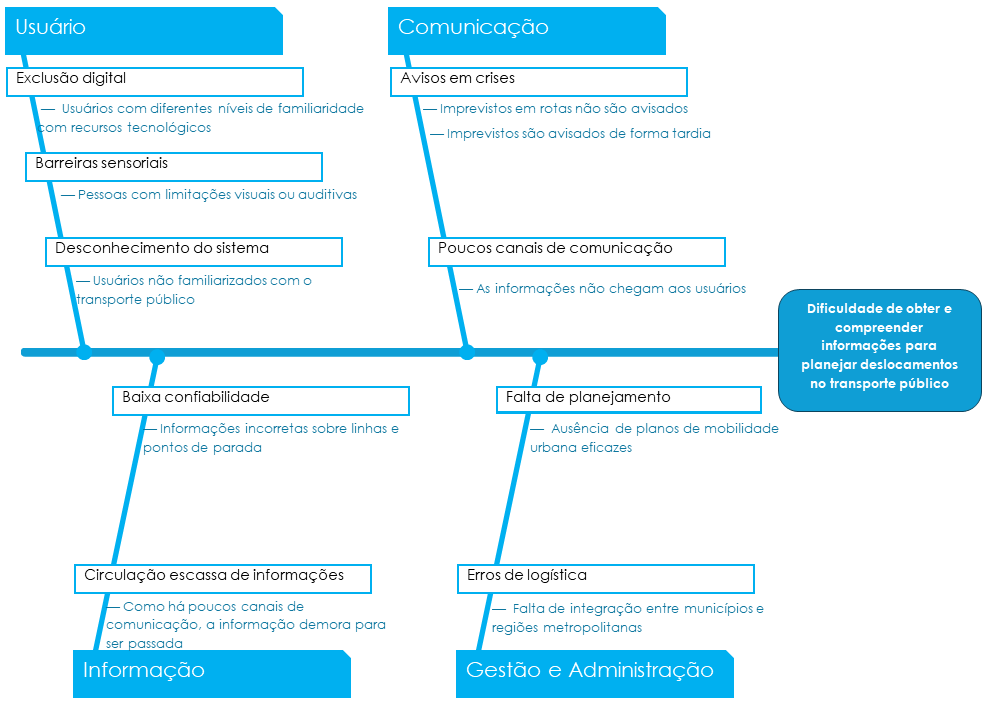
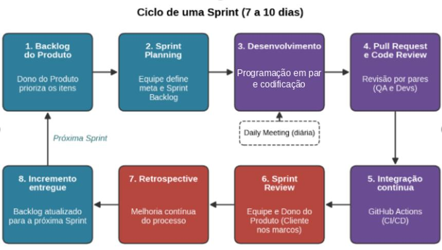

# RotasDF — Visão do Produto e do Projeto

**T02_KNUTH — RotasDF** · Versão 1.1.0

## Integrantes do Grupo

| Matrícula | Nome | Função (responsabilidade) | Pontos de participação |
|---|---|---|---|
| 252014223 | Gabriel Sakai e Silva | Analista de qualidade / desenvolvedor | 16,6 |
| 242015601 | Emanuele Victor Santos | Scrum Master / Líder do grupo / desenvolvedor | 16,6 |
| 232013990 | Gabriel Felix Mota Soares | Dono do produto | 16,6 |
| 190128160 | Guilherme Maciel de Meneses | Desenvolvedor | 16,6 |
| 222024819 | Gabriela Xavier Rodrigues | Desenvolvedor | 16,6 |
| 242015460 | Denilson Lima Santos | Desenvolvedor | 16,6 |
| | **Total de pontos** (devem fechar 100 para toda a equipe) | | **100** |

## Histórico de Revisões

| Data | Versão | Descrição | Autor |
|---|---|---|---|
| 30/09/2026 | 1.0.0 | Visão inicial do produto | Todos |
| 27/10/2026 | 1.1.0 | Alinhamento do modelo de branches e retirada do método TDD | Gabriel Sakai e Silva |

## Sumário

1. [Visão geral do produto](#1-visão-geral-do-produto)
   - [1.1 Problema](#11-problema)
   - [1.2 Declaração de posição do produto](#12-declaração-de-posição-do-produto)
   - [1.3 Objetivos do produto](#13-objetivos-do-produto)
   - [1.4 Tecnologias a serem utilizadas](#14-tecnologias-a-serem-utilizadas)
2. [Visão geral do projeto](#2-visão-geral-do-projeto)
   - [2.1 Ciclo de vida do projeto](#21-ciclo-de-vida-do-projeto-de-desenvolvimento-de-software)
   - [2.2 Organização do projeto](#22-organização-do-projeto)
   - [2.3 Planejamento das fases/iterações](#23-planejamento-das-fases-eou-iterações-do-projeto)
   - [2.4 Matriz de comunicação](#24-matriz-de-comunicação)
   - [2.5 Gerenciamento de riscos](#25-gerenciamento-de-riscos)
3. [Processo de desenvolvimento de software](#3-processo-de-desenvolvimento-de-software)
4. [Declaração de escopo do projeto](#4-declaração-de-escopo-do-projeto)
   - [4.1 Backlog do produto](#41-backlog-do-produto)
   - [4.2 Perfis](#42-perfis)
   - [4.3 Cenários](#43-cenários)
   - [4.4 Tabela de backlog do produto](#44-tabela-de-backlog-do-produto)
5. [Métricas e medições](#5-métricas-e-medições)
6. [Testes de software](#6-testes-de-software)
7. [Referências bibliográficas](#7-referências-bibliográficas)

---

## 1 Visão geral do produto

### 1.1 Problema

O transporte público é um dos principais meios de locomoção da população urbana, sendo a base essencial para a mobilidade de grande parte das pessoas nas cidades. Ademais, além de garantir o direito de locomoção da população, o transporte público contribui para a inclusão social ao oferecer uma alternativa de deslocamento acessível para pessoas que não possuem veículo próprio.

No entanto, muitos usuários passam por dificuldades para obter e interpretar as informações necessárias para o planejamento de suas viagens devido a causas variáveis, conforme explicitado pela Figura 1.

<b>Figura 1: Diagrama de Ishikawa (Causa x Efeito)</b>

<i>Fonte: Elaborado pelos autores (2026)</i>

Diante do cenário apresentado, propõe-se o desenvolvimento de uma plataforma digital capaz de fornecer informações essenciais para o planejamento dos deslocamentos dos usuários de transporte público, contribuindo para a mitigação do efeito apresentado no diagrama, por meio do tratamento das causas relacionadas à informação, à comunicação e ao usuário.

### 1.2 Declaração de posição do produto

O produto irá se diferenciar por sua acessibilidade e facilidade de uso, permitindo que usuários com diferentes níveis de afinidade tecnológica tenham acesso rápido e intuitivo às informações. Dessa forma, o sistema busca promover a inclusão digital e facilitar o acesso a informações essenciais para o planejamento dos deslocamentos urbanos, conforme demonstrado na Tabela 1.

**Tabela 1: Especificações do produto**

| Item | Descrição |
|---|---|
| Para | Usuários de transporte público |
| Necessidade | Uma plataforma que ajude os usuários a planejarem suas viagens |
| Identificação do produto | É um aplicativo mobile, com o nome de "RotasDF" |
| Que | Disponibiliza informações confiáveis sobre linhas, horários e alterações nos serviços |
| Ao contrário | Escassez de informação transformando o transporte público mais imprevisível para os usuários |
| Nosso produto | Entrega informações acessíveis e de fácil entendimento |

*Fonte: Elaborado pelos autores (2026)*

### 1.3 Objetivos do produto

O produto busca reduzir as dificuldades enfrentadas pelos usuários de transporte público, disponibilizando dados sobre linhas, horários e alterações operacionais. Dessa maneira, o projeto contribui para um planejamento mais eficiente dos deslocamentos, reduzindo a imprevisibilidade do transporte público e melhorando a experiência dos usuários.

### 1.4 Tecnologias a serem utilizadas

Serão utilizadas as seguintes tecnologias:

- GitHub
- VS Code
- Python
- Node.js
- React
- HTML5
- CSS3
- PostgreSQL
- Docker

---

## 2 Visão geral do projeto

### 2.1 Ciclo de vida do projeto de desenvolvimento de software

O tema do projeto é a plataforma de transporte público, com foco na melhoria da experiência dos usuários. O problema identificado consiste na dificuldade que esses usuários têm para obter e interpretar as informações necessárias ao planejamento de seus deslocamentos, como opções de trajetos, linhas, horários e alterações no serviço. Nesse contexto, o projeto busca responder à seguinte questão de pesquisa: **como facilitar o acesso e a compreensão das informações necessárias para que usuários do transporte público possam planejar seus deslocamentos?** Como solução, propõe-se uma plataforma que reúna a consulta de rotas, linhas, horários e alertas de alteração do serviço em uma interface responsiva.

Para a concepção e o desenvolvimento da plataforma, definiu-se um ciclo de vida de desenvolvimento de software ágil, estruturado com base em um modelo iterativo e incremental. A escolha por este modelo justifica-se pela necessidade de adaptação contínua diante da evolução dos requisitos, refinamento constante das funcionalidades de consulta de rotas e integração progressiva dos módulos do sistema.

A estrutura do ciclo de vida desdobra-se nos seguintes componentes formais:

**a) Metodologia:** adotou-se o paradigma do Desenvolvimento Ágil de Software. A escolha fundamenta-se nos valores do Manifesto Ágil, que priorizam software em funcionamento, colaboração constante entre os membros e capacidade de resposta a mudanças em detrimento do acompanhamento rígido de um plano inicial. No contexto de um sistema de transporte público, no qual regras de negócio, linhas e horários podem sofrer alterações, essa abordagem minimiza riscos de retrabalho e garante entregas de valor contínuas a cada iteração.

**b) Processo:** a estrutura e a gestão do trabalho são regidas pelo framework Scrum. O ciclo de desenvolvimento organiza-se em Sprints semanais no período de codificação, nas quais o escopo do projeto é fatiado em incrementos funcionais do produto. A equipe realiza os rituais formais do framework: *Sprint Planning* para seleção e estimativa de itens do Backlog, *Daily Meetings* para alinhamento diário e identificação de impedimentos, e *Sprint Review* acompanhada de *Retrospective* ao final de cada iteração para avaliação dos entregáveis e melhoria contínua do processo.

**c) Procedimentos (guia e modo de fazer):** a execução técnica orienta-se pelas práticas do Extreme Programming (XP). Estabeleceram-se diretrizes formais de codificação, integração contínua a cada alteração aprovada no repositório, refatoração constante para manutenção do código limpo e a obrigatoriedade de revisão por pares (*Code Review*) por meio de Pull Requests antes da incorporação de qualquer funcionalidade ao ramo principal (`main`).

**d) Métodos:** são aplicadas as seguintes técnicas estruturadas durante o desenvolvimento:

- **Testes unitários:** escrita de testes automatizados para validação das regras de negócio do sistema após a implementação do código funcional;
- **Programação em par (*Pair Programming*):** atuação conjunta de dois desenvolvedores na construção de módulos mais complexos para redução de defeitos e disseminação de conhecimento técnico na equipe;
- **Elicitação e modelagem de requisitos via User Stories:** especificação dos cenários funcionais e de uso no formato padronizado de Histórias de Usuário.

**e) Ferramentas (instrumentos para realização das tarefas):** a execução prática é suportada pelo seguinte ecossistema tecnológico:

- *Gestão e versionamento:* GitHub para controle de versão distribuído (Git) e GitHub Projects para acompanhamento transparente do fluxo de tarefas (A Fazer, Em Andamento, Em Revisão, Concluído);
- *Ambiente e automação:* Visual Studio Code (VS Code) como ambiente integrado de desenvolvimento (IDE) e GitHub Actions para automação do pipeline de Integração Contínua (CI/CD);
- *Linguagens e frameworks:* Python / Node.js para construção das APIs e regras de negócio no back-end, e React / HTML5 / CSS3 para o desenvolvimento da interface responsiva no front-end;
- *Banco de dados e containerização:* PostgreSQL para persistência e gestão dos dados de rotas, frotas e horários, e Docker para padronização dos ambientes de desenvolvimento e implantação.

Assim, a combinação entre entregas semanais, práticas de qualidade de código e validação frequente nas inspeções e pontos de controle da disciplina permite que as funcionalidades de consulta sejam refinadas a cada iteração, aproximando a solução da necessidade real dos usuários e respondendo à questão de pesquisa de forma incremental.

### 2.2 Organização do projeto

A estrutura organizacional da equipe foi planejada para promover a responsabilidade compartilhada e a colaboração contínua ao longo de todo o ciclo de vida do desenvolvimento do software. Visando evitar gargalos operacionais e garantir a aplicação das práticas ágeis do Scrum e do Extreme Programming (XP), os papéis e as responsabilidades foram distribuídos de forma transparente entre os integrantes do grupo, conforme detalhado na Tabela 3. Ressalta-se que essa divisão de atribuições não estabelece qualquer relação de hierarquia ou grau de importância: todos os integrantes são igualmente importantes e responsáveis pelo sucesso do projeto.

**Tabela 3: Divisão de papéis e responsabilidades da equipe do projeto**

| Papel | Atribuições | Responsável | Participantes |
|---|---|---|---|
| Desenvolvedor | Codificar o produto, codificar testes unitários, realizar refatoração | Todos os integrantes do grupo | Denilson, Emanuele, Gabriela, Gabriel Felix, Guilherme, Gabriel Sakai |
| Dono do Produto | Atualizar o escopo do produto, organizar o escopo das sprints, validar as entregas | Gabriel Felix | Gabriel Felix |
| Analista de Qualidade | Garantir a qualidade do produto, garantir o cumprimento do conceito de pronto, realizar inspeções de código | Gabriel Sakai | Gabriel Sakai, Gabriela |
| Cliente | Validar a usabilidade e fornecer feedbacks nas revisões de sprint | Professor e monitor da disciplina | Ricardo Ajax, Arthur |
| Scrum Master | Facilitar as cerimônias, garantir a aplicação das práticas ágeis, remover impedimentos | Emanuele | Emanuele |

*Fonte: Elaborado pelos autores (2026)*

### 2.3 Planejamento das fases e/ou iterações do projeto

O planejamento do projeto está organizado em cinco Sprints semanais, executadas de 26/10/2026 a 29/11/2026, período definido pelo cronograma da disciplina para o desenvolvimento do software. Cada Sprint está associada a um produto (entrega) e a entregáveis específicos, conforme apresentado na Tabela 4, e a distribuição das funcionalidades segue o Backlog do Produto (seção 4.4). Esse planejamento é atualizado de maneira sucessiva, a cada ciclo de desenvolvimento, com base nos resultados da Sprint Review e da Retrospective, de modo que datas, entregáveis e percentuais de conclusão reflitam sempre a situação real do projeto.

**Tabela 4: Planejamento das Sprints do projeto**

| Sprint | Produto (Entrega) | Início | Fim | Entregável(eis) | Responsáveis | % conclusão |
|---|---|---|---|---|---|---|
| S1 | Módulo Base | 26/10/2026 | 01/11/2026 | Busca de linha por número ou nome; itinerário da linha; quadro de horários da linha; importação de dados de transporte | Equipe de Desenvolvimento e Analista de Qualidade | 0% |
| S2 | Núcleo de trajetos (MVP) | 02/11/2026 | 08/11/2026 | Busca de trajeto entre origem e destino; trajeto detalhado em etapas; localização atual como origem; linhas que atendem uma parada; buscas recentes | Equipe de Desenvolvimento e Dono do Produto | 0% |
| S3 | Alertas, Gestão Administrativa | 09/11/2026 | 15/11/2026 | Consulta de alertas vigentes; autenticação de administrador; cadastro e gestão de alertas; manutenção de linhas, paradas e horários; apresentação no ponto de controle | Equipe de Desenvolvimento e Analista de Qualidade | 0% |
| S4 | Inspeção de Software, Qualidade & Personalização | 16/11/2026 | 22/11/2026 | Sinalização de alertas nos itens afetados; cadastro e autenticação de passageiro; favoritos; reporte de divergências; análise de reportes; inspeção do repositório e início da correção dos defeitos | Equipe de Desenvolvimento e Analista de Qualidade | 0% |
| S5 | Recursos Avançados, Refinamento & Entrega Final | 23/11/2026 | 29/11/2026 | Trajeto no mapa; comparação e ordenação de trajetos; planejamento por horário de partida ou chegada; próximas partidas em uma parada; previsão de chegada em tempo real; notificação de alterações em favoritos; correção dos defeitos restantes; versão final | Todos os papéis | 0% |

*Fonte: Elaborado pelos autores (2026)*

Como mostra a Tabela 4, as Sprints foram alinhadas aos marcos do cronograma da disciplina. O ponto de controle ocorre no início da Sprint 3, quando o módulo base e o núcleo de trajetos (Sprints 1 e 2) já estão disponíveis, e a inspeção dos repositórios ocorre no início da Sprint 4, o que permite corrigir os defeitos apontados antes da apresentação final. As funcionalidades de prioridade *Must* concentram-se nas quatro primeiras Sprints, e as classificadas como *Should* e *Could* ficam, em sua maioria, para as finais.

### 2.4 Matriz de comunicação

**Tabela 5: Matriz de comunicação**

| Descrição | Área / Envolvidos | Periodicidade | Produtos gerados |
|---|---|---|---|
| Acompanhamento das atividades em andamento; acompanhamento dos riscos, compromissos, ações pendentes, indicadores | Equipe do Projeto | Semanal | Ata de reunião; relatório de situação do projeto |
| Acompanhamento das necessidades e prioridades do produto | Product Owner; Equipe de Desenvolvimento | Semanal | Backlog do Produto atualizado |
| Comunicar situação do projeto | Equipe; Prof./Monitor | Semanal | Ata de reunião; relatório de situação do projeto |

*Fonte: Elaborado pelos autores (2026)*

### 2.5 Gerenciamento de riscos

**Tabela 6: Riscos**

| Risco | Grau de exposição | Mitigação | Plano de contingência |
|---|---|---|---|
| Falhas na integração ou obtenção dos dados de transporte | Alto | Realização de testes prévios | Realizar possíveis mudanças nas sprints |
| Membros do grupo trancar matéria | Médio | Realizar sprints em pares | Reajustar a distribuição das sprints |
| Desenvolvedores não saberem o que fazer na sprint | Alto | Realizar sprints em pares | Realizar possíveis mudanças nas sprints |
| Atraso na conclusão das atividades da sprint | Médio | Acompanhar as atividades durante a sprint e identificar impedimentos antecipadamente | Repriorizar atividades e transferir itens não concluídos para uma sprint posterior |

*Fonte: Elaborado pelos autores (2026)*

#### Critérios de replanejamento

O replanejamento do projeto será realizado quando forem identificadas situações que possam comprometer o cumprimento do cronograma, dos requisitos ou dos objetivos estabelecidos. Entre os principais critérios para o replanejamento estão: ocorrência de riscos de alto grau de exposição; atrasos significativos nas atividades previstas; alterações nos requisitos do projeto. Quando um desses critérios for identificado, a equipe irá avaliar seu impacto sobre o escopo, prazo e atividades previstas, realizando os ajustes necessários no planejamento, e as possíveis alterações realizadas deverão ser registradas.

---

## 3 Processo de desenvolvimento de software

Esta seção registra, de forma objetiva e orientadora, as decisões da equipe quanto ao processo de desenvolvimento de software, com base no Scrum e no Extreme Programming (XP), em alinhamento com o ciclo de vida descrito na seção 2.1. Entende-se por processo um conjunto de atividades logicamente encadeadas, com início e fim, que consomem recursos, geram resultados e possuem papéis responsáveis.

No projeto, o desenvolvimento ocorre de 26/10/2026 a 29/11/2026, período definido pelo cronograma da disciplina, e é organizado em cinco Sprints semanais, iniciadas às segundas-feiras. Cada Sprint começa com o Backlog do Produto priorizado e termina com um incremento validado e entregue, utilizando como recursos o repositório no GitHub, o quadro Kanban e o *pipeline* de integração contínua. O fluxo de trabalho de cada Sprint está ilustrado na Figura 2.

<b>Figura 2: Fluxo de trabalho de uma Sprint do projeto</b>

<i>Fonte: Elaborada pelos autores (2026)</i>

As atividades do fluxo, com seus responsáveis e resultados, são:

- **a) Refinamento e priorização do Backlog:** o Dono do Produto prioriza as *User Stories*, gerando o Backlog do Produto priorizado;
- **b) Sprint Planning:** toda a equipe seleciona os itens que serão desenvolvidos, gerando o Sprint Backlog e a meta da Sprint;
- **c) Desenvolvimento:** a Equipe de Desenvolvimento codifica aplicando *Pair Programming* e *Coding Standards*, gerando um incremento de código validado por testes unitários;
- **d) Daily Meeting:** a equipe, facilitada pelo Scrum Master, alinha o andamento das tarefas no quadro Kanban e identifica impedimentos;
- **e) Pull Request e Code Review:** o Analista de Qualidade e os desenvolvedores revisam o código, que, uma vez aprovado, é integrado ao ramo principal (`main`);
- **f) Integração contínua:** o *pipeline* do GitHub Actions executa os testes automatizados a cada integração;
- **g) Sprint Review:** a equipe apresenta o incremento ao Dono do Produto e, nos marcos do cronograma da disciplina (pontos de controle, inspeções e apresentações), ao Cliente / Usuário (simulação), que registram seus *feedbacks*;
- **h) Retrospective:** a equipe, facilitada pelo Scrum Master, define ações de melhoria para a próxima Sprint.

Além do fluxo interno de cada Sprint, o processo considera os marcos definidos no cronograma da disciplina:

- **a) Início do desenvolvimento (26/10/2026):** a equipe inicia de fato o desenvolvimento do software planejado;
- **b) Ponto de controle (09/11/2026 ou 11/11/2026):** a equipe apresenta o que foi desenvolvido até o momento, em 15 minutos, com presença obrigatória da turma;
- **c) Inspeção (16/11/2026):** equipes inspetoras avaliam os repositórios das equipes inspecionadas, e o professor divulga o resultado em 18/11/2026;
- **d) Correção de defeitos (a partir de 18/11/2026):** a equipe repara os defeitos apontados nas inspeções;
- **e) Apresentação do software em funcionamento (30/11/2026 ou 02/12/2026):** a equipe apresenta a versão final do produto.

Como os repositórios são inspecionados e auditados, o quadro Kanban, os Pull Requests e o planejamento da seção 2.3 devem ser mantidos atualizados a cada Sprint.

Para garantir o alinhamento entre as etapas, a equipe adota um conceito de pronto (*Definition of Done*). Considera-se pronto o item do Backlog que atender cumulativamente aos seguintes critérios:

- a) testes unitários implementados e aprovados;
- b) integração contínua executada sem falhas;
- c) revisão por pares aprovada por meio de Pull Request;
- d) critérios de aceitação validados pelo Dono do Produto.

---

## 4 Declaração de escopo do projeto

O escopo do projeto da plataforma de transporte público visa atender à necessidade de facilitar o acesso e a compreensão das informações para o planejamento de deslocamentos. O escopo é detalhado por meio da identificação dos perfis de usuários, mapeamento de cenários funcionais e construção do backlog do produto.

### 4.1 Backlog do produto

O backlog do produto consiste na lista priorizada de todas as funcionalidades e requisitos técnicos necessários para a construção da plataforma. As funcionalidades foram priorizadas seguindo o método MoSCoW (*Must*, *Should*, *Could*) para alinhar as entregas de maior valor às Sprints do projeto.

- **Análise de documentos e padrões:** estudo do formato de dados GTFS (fonte oficial de transporte) e análise de soluções similares no mercado para embasar os requisitos de gestão de dados e alertas de serviço.
- **Criação de personas e histórias de usuário (User Stories):** utilizadas para mapear a jornada do "Passageiro" e do "Administrador", garantindo que os requisitos fossem escritos sob a ótica de quem utilizará o sistema.
- **Brainstorming com a equipe:** reuniões com os desenvolvedores para levantamento e definição dos requisitos não funcionais, como responsividade, acessibilidade e regras de manutenibilidade do código.

### 4.2 Perfis

**Tabela 7: Perfis de acesso**

| # | Nome do perfil | Características do perfil | Permissões de acesso |
|---|---|---|---|
| 1 | Passageiro Anônimo | Usuário comum que utiliza o transporte público e busca informações de forma rápida, sem desejo de criar vínculo formal | Acesso livre para buscar trajetos, consultar linhas, itinerários, horários e visualizar alertas de alterações no serviço |
| 2 | Passageiro Cadastrado | Usuário frequente que deseja personalizar sua experiência e manter um histórico de uso na plataforma (e-mail e senha) | Todas as permissões do Passageiro Anônimo, acrescidas de: criar conta, autenticar-se, salvar linhas/paradas favoritas, consultar buscas recentes e reportar divergências de informação |
| 3 | Administrador | Usuário interno responsável pela manutenção da base | Acesso restrito mediante login para importar dados de transporte (ex.: GTFS), cadastrar/gerenciar alertas de alteração, manter dados de linhas/horários e analisar os reportes enviados pelos passageiros |

*Fonte: Elaborado pelos autores (2026)*

### 4.3 Cenários

**Tabela 8: Cenários funcionais** — Sistema: Plataforma de Transporte Público

| Cenário | Nome do cenário | Sprints |
|---|---|---|
| C1 | Planejamento de trajetos | S2, S5 |
| C2 | Consulta de linhas e paradas | S1, S2 |
| C3 | Consulta de horários | S1, S5 |
| C4 | Alterações no serviço | S3, S4, S5 |
| C5 | Conta e personalização do passageiro | S2, S4 |
| C6 | Gestão dos dados de transporte (Administrador) | S1, S3, S4 |

*Fonte: Elaborado pelos autores (2026)*

### 4.4 Tabela de backlog do produto

Abaixo é apresentado o detalhamento dos requisitos funcionais (RF) e gerais não funcionais (RNF), vinculados aos seus cenários, Sprints estimadas e respectivas Histórias de Usuário.

**Tabela 9: Backlog do produto** — Sistema: Plataforma de Transporte Público

#### C1 – Planejamento de trajetos

| Requisito | Sprint | Nome | Tipo | Prioridade | Descrição | User Story |
|---|---|---|---|---|---|---|
| C1 / RF01 | S2 | Buscar trajeto entre origem e destino | Funcional | Must | O sistema deve permitir que o usuário informe origem e destino (endereço, ponto de referência ou parada) e retornar as opções de trajeto disponíveis, com linhas, baldeações e tempo total estimado. | **US01** – Como passageiro, quero informar origem e destino para descobrir quais linhas e combinações me levam até onde preciso. |
| C1 / RF02 | S2 | Exibir trajeto detalhado em etapas | Funcional | Must | O sistema deve apresentar cada opção de trajeto em etapas sequenciais (caminhada até a parada, linha a embarcar, quantidade de paradas, ponto de desembarque e baldeações), em linguagem simples. | **US02** – Como passageiro, quero ver o trajeto dividido em etapas para saber exatamente onde embarcar, onde descer e onde trocar de linha. |
| C1 / RF03 | S2 | Usar localização atual como origem | Funcional | Should | O sistema deve permitir, mediante autorização do usuário, utilizar a localização do dispositivo como ponto de origem da busca. | **US03** – Como passageiro, quero usar minha localização atual como origem para não precisar digitar o endereço de onde estou. |
| C1 / RF04 | S5 | Visualizar trajeto no mapa | Funcional | Should | O sistema deve exibir o trajeto selecionado em um mapa, destacando o percurso de cada linha, as paradas de embarque e desembarque e os trechos a pé. | **US04** – Como passageiro, quero ver o trajeto desenhado no mapa para localizar com facilidade as paradas de embarque e desembarque. |
| C1 / RF05 | S5 | Comparar e ordenar opções de trajeto | Funcional | Should | O sistema deve permitir ordenar e filtrar as opções de trajeto por menor tempo total, menor número de baldeações e menor distância de caminhada. | **US05** – Como passageiro, quero ordenar as opções por tempo, baldeações ou caminhada para escolher a que melhor atende à minha necessidade. |
| C1 / RF06 | S5 | Planejar viagem por horário de partida ou chegada | Funcional | Could | O sistema deve permitir que o usuário defina o horário desejado de partida ou de chegada, considerando o quadro de horários das linhas no cálculo do trajeto. | **US06** – Como passageiro, quero informar o horário em que desejo sair ou chegar para planejar minhas viagens com antecedência. |

#### C2 – Consulta de linhas e paradas

| Requisito | Sprint | Nome | Tipo | Prioridade | Descrição | User Story |
|---|---|---|---|---|---|---|
| C2 / RF07 | S1 | Buscar linha por número ou nome | Funcional | Must | O sistema deve permitir buscar linhas pelo número ou pelo nome, com sugestões automáticas durante a digitação. | **US07** – Como passageiro, quero buscar uma linha pelo número ou pelo nome para acessar rapidamente suas informações. |
| C2 / RF08 | S1 | Consultar itinerário da linha | Funcional | Must | O sistema deve exibir o itinerário da linha, com a sequência de paradas em cada sentido, em formato de lista e de mapa. | **US08** – Como passageiro, quero ver as paradas da linha em cada sentido para confirmar se ela passa pelo local de que preciso. |
| C2 / RF09 | S2 | Consultar linhas que atendem uma parada | Funcional | Should | O sistema deve permitir selecionar uma parada, por busca ou pelo mapa, e listar todas as linhas que a atendem. | **US09** – Como passageiro, quero selecionar uma parada e ver quais linhas passam por ela para conhecer minhas opções a partir daquele ponto. |

#### C3 – Consulta de horários

| Requisito | Sprint | Nome | Tipo | Prioridade | Descrição | User Story |
|---|---|---|---|---|---|---|
| C3 / RF10 | S1 | Consultar quadro de horários da linha | Funcional | Must | O sistema deve exibir o quadro de horários da linha, separado por sentido e por tipo de dia (dias úteis, sábados, domingos e feriados). | **US10** – Como passageiro, quero consultar os horários da linha por sentido e tipo de dia para programar o momento da minha saída. |
| C3 / RF11 | S5 | Consultar próximas partidas em uma parada | Funcional | Should | O sistema deve exibir, para uma parada selecionada, os próximos horários programados de passagem de cada linha que a atende. | **US11** – Como passageiro, quero ver os próximos horários previstos em uma parada para saber quanto tempo vou esperar. |
| C3 / RF12 | S5 | Exibir previsão de chegada em tempo real | Funcional | Could | O sistema deve exibir a previsão de chegada dos veículos com base na localização em tempo real da frota, quando esse dado estiver disponível na fonte oficial. | **US12** – Como passageiro, quero ver a previsão de chegada do ônibus em tempo real para reduzir meu tempo de espera na parada. |

#### C4 – Alterações no serviço

| Requisito | Sprint | Nome | Tipo | Prioridade | Descrição | User Story |
|---|---|---|---|---|---|---|
| C4 / RF13 | S3 | Consultar alertas de alteração vigentes | Funcional | Must | O sistema deve disponibilizar uma área com todos os alertas vigentes (desvios, suspensões, alterações de horário e paralisações), informando tipo, linhas e paradas afetadas, período e descrição. | **US13** – Como passageiro, quero ver em um só lugar as alterações vigentes no serviço para saber se meus deslocamentos serão afetados. |
| C4 / RF14 | S4 | Sinalizar alterações nos itens afetados | Funcional | Must | O sistema deve destacar visualmente, nas telas de linha e de parada e nos resultados de trajeto, os alertas que afetam os itens exibidos. | **US14** – Como passageiro, quero ser avisado na tela da linha, da parada ou do trajeto quando houver alteração que os afete, para não ser surpreendido durante a viagem. |
| C4 / RF15 | S5 | Notificar alterações em itens favoritos | Funcional | Could | O sistema deve notificar o usuário cadastrado, por e-mail ou notificação do navegador, quando for publicado alerta que afete linhas ou paradas salvas como favoritas. | **US15** – Como passageiro cadastrado, quero ser notificado quando uma linha favorita sofrer alteração para me planejar com antecedência. |

#### C5 – Conta e personalização do passageiro

| Requisito | Sprint | Nome | Tipo | Prioridade | Descrição | User Story |
|---|---|---|---|---|---|---|
| C5 / RF16 | S4 | Cadastrar e autenticar passageiro | Funcional | Should | O sistema deve permitir o cadastro de passageiros com e-mail e senha, bem como autenticação, recuperação de senha e exclusão da conta. | **US16** – Como passageiro, quero criar uma conta e acessá-la com e-mail e senha para manter minhas preferências salvas entre dispositivos. |
| C5 / RF17 | S4 | Salvar linhas, paradas e trajetos favoritos | Funcional | Should | O sistema deve permitir ao passageiro cadastrado salvar e remover linhas, paradas e trajetos favoritos, exibidos com destaque na tela inicial. | **US17** – Como passageiro cadastrado, quero salvar as linhas, paradas e trajetos que uso com frequência para consultá-los com um toque. |
| C5 / RF18 | S2 | Consultar buscas recentes | Funcional | Could | O sistema deve armazenar e exibir as últimas buscas de trajeto e de linha realizadas pelo usuário, permitindo repeti-las. | **US18** – Como passageiro, quero ver minhas buscas recentes para repetir uma consulta sem precisar digitar tudo novamente. |
| C5 / RF19 | S4 | Reportar divergência na informação | Funcional | Could | O sistema deve permitir ao usuário reportar divergências nas informações exibidas (horário, parada ou itinerário), indicando a linha ou parada relacionada. | **US19** – Como passageiro, quero reportar uma informação incorreta para ajudar a manter os dados da plataforma confiáveis. |

#### C6 – Gestão dos dados de transporte (Administrador)

| Requisito | Sprint | Nome | Tipo | Prioridade | Descrição | User Story |
|---|---|---|---|---|---|---|
| C6 / RF20 | S1 | Importar dados de transporte | Funcional | Must | O sistema deve importar dados de linhas, paradas, itinerários e horários a partir de fonte oficial em formato padronizado (ex.: GTFS), validando-os antes de atualizar a base. | **US20** – Como administrador, quero importar os dados oficiais de linhas, paradas, itinerários e horários para manter a base da plataforma atualizada. |
| C6 / RF21 | S3 | Autenticar administrador | Funcional | Must | O sistema deve restringir as funcionalidades de gestão ao perfil Administrador, mediante autenticação. | **US21** – Como administrador, quero acessar uma área restrita com login próprio para gerenciar os dados sem que outros usuários possam alterá-los. |
| C6 / RF22 | S3 | Cadastrar e gerenciar alertas | Funcional | Must | O sistema deve permitir ao administrador cadastrar, editar e encerrar alertas, informando tipo, descrição, linhas e paradas afetadas e período de vigência; alertas vencidos devem ser retirados automaticamente. | **US22** – Como administrador, quero cadastrar alertas com tipo, itens afetados e período de vigência para comunicar as alterações no serviço aos passageiros. |
| C6 / RF23 | S3 | Manter linhas, paradas e horários | Funcional | Should | O sistema deve permitir ao administrador incluir, alterar e excluir linhas, paradas, itinerários e horários manualmente. | **US23** – Como administrador, quero corrigir manualmente dados de linhas, paradas e horários para tratar divergências sem aguardar uma nova importação. |
| C6 / RF24 | S4 | Analisar reportes de usuários | Funcional | Could | O sistema deve listar os reportes recebidos, permitindo ao administrador classificá-los (pendente, procedente ou improcedente) e registrar a correção realizada. | **US24** – Como administrador, quero analisar os reportes enviados pelos passageiros para identificar e corrigir informações incorretas. |

*Fonte: Elaborado pelos autores (2026)*

---

## 5 Métricas e medições

### 5.1 GQM de medições

#### Objetivo de medição 1

- **Objeto:** acompanhamento do progresso de conclusão de histórias de usuário
- **Finalidade:** avaliar o quanto foi possível render durante o projeto
- **Foco:** capacidade de implementação dos membros em cada sprint
- **Viewpoint:** do ponto de vista da equipe do projeto
- **Contexto:** projeto de mobilidade urbana desenvolvido com ciclos de sprints semanais

**Questão 1:** Qual percentual de histórias de usuário os membros conseguem implementar em cada sprint?

**Métrica 1 — Histórias de usuário concluídas por sprint**

- **5W+1H:**
  - *What:* histórias concluídas.
  - *Why:* acompanhar a capacidade de desenvolvimento da equipe.
  - *Who:* equipe de desenvolvimento.
  - *When:* ao final de cada sprint.
  - *Where:* Sprint Backlog.
  - *How:* contabilizando as histórias concluídas.
- **Definição:** quantidade de histórias de usuário concluídas ao final de cada sprint.
- **Forma de cálculo:** contagem das histórias que foram concluídas na sprint.
- **Unidade/escala:** (Histórias concluídas ÷ Histórias planejadas) × 100
- **Valor esperado:** pelo menos 80%
- **Forma de análise:** comparar a quantidade de histórias concluídas entre as sprints e observar a evolução ao final.

#### Objetivo de medição 2

- **Objeto:** acompanhamento da cobertura dos testes sobre o código desenvolvido
- **Finalidade:** avaliar o quanto foi possível render durante o projeto
- **Foco:** cobertura do código pelos testes realizados em cada sprint
- **Viewpoint:** do ponto de vista da equipe do projeto
- **Contexto:** projeto de mobilidade urbana desenvolvido com ciclos de sprints semanais

**Questão 2:** Qual percentual do código desenvolvido é coberto pelos testes em cada sprint?

**Métrica 2 — Cobertura do código**

- **5W+1H:**
  - *What:* código coberto pelos testes.
  - *Why:* acompanhar a cobertura dos testes sobre o código desenvolvido.
  - *Who:* equipe de desenvolvimento.
  - *When:* ao final de cada sprint.
  - *Where:* código-fonte do projeto.
  - *How:* comparando o código executado pelos testes com o código total analisado.
- **Forma de cálculo:** percentual do código desenvolvido que é executado durante a realização dos testes.
- **Unidade/escala:** (Código executado pelos testes ÷ Código total analisado) × 100
- **Valor esperado:** pelo menos 80%
- **Forma de análise:** comparar o percentual de cobertura de código entre as sprints e verificar se a cobertura está se mantendo ou evoluindo ao longo do projeto.

---

## 6 Testes de software

### 6.1 Estratégia de testes

A estratégia de testes visa assegurar a estabilidade, a corretude e a facilidade de uso da plataforma de transporte público. As diretrizes adotadas para a execução são:

**Níveis de testes abordados:**

- **Unitário:** testes focados em validar isoladamente as menores partes do código, como a função matemática que calcula a distância entre o usuário e o ponto de ônibus.
- **Integração:** testes destinados a verificar a comunicação correta entre os diferentes módulos, como a integração do aplicativo (front-end) com a API de mapas e servidores de horários das viações de ônibus.
- **Sistema:** testes globais para verificar o fluxo completo da aplicação em simulação de uso real, validando o comportamento do sistema inteiro desde a busca da rota até a chegada ao destino.

**Tipos de testes abordados:**

- **Funcionais:** validação das regras de negócio. Exemplo: garantir que o sistema não indique rotas inexistentes ou horários incorretos.

**Ambientes de testes usados:** o ambiente de testes seguirá estritamente a política de branches e commits do projeto:

- **Ambiente de Desenvolvimento (branches `feature/*`):** onde os desenvolvedores criarão funcionalidades e executarão os testes unitários locais.
- **Ambiente de Integração (branch `developer`):** ambiente interno da equipe de desenvolvimento para consolidar os commits, rodar testes de integração e realizar os últimos testes e validações antes da apresentação.
- **Ambiente de Produção (branch `main`):** versão estável liberada para o usuário final.
- **Ambiente de documentação (branch `main`):** onde a documentação do projeto é mantida e atualizada.

**Formas de análise dos testes propostos:** a análise será realizada por meio da execução metódica do roteiro de testes em homologação. Para as questões funcionais, será feita inspeção de resultados. Para os testes de usabilidade, utilizaremos o método de observação direta do usuário interagindo com as telas de rotas e horários.

**Resultados obtidos (Previstos × Realizados):** o parâmetro para aprovação de qualquer funcionalidade será a comparação exata entre o "Resultado Previsto" (como o sistema foi projetado para agir) e o "Resultado Realizado" (como o sistema agiu de fato durante a execução do roteiro). A lógica de aprovação obedecerá à seguinte regra: se o resultado previsto for diferente do realizado, o teste não passou e um defeito (*bug*) foi identificado. Esse defeito será registrado, reparado pela equipe e o teste será executado em novos ciclos até que o resultado Previsto seja igual ao Realizado, caracterizando a aprovação e a ausência de defeitos.

### 6.2 Roteiro de testes

#### CT-01 — Busca de Trajeto Completo

- **Objetivo do teste:** validar se o sistema retorna as rotas e opções de ônibus corretas.
- **Nível do teste:** Sistema
- **Tipo de teste:** Funcional
- **Precondições:** aparelho com acesso à internet no ambiente *staging*. GPS ativado.
- **Definição de aceite (Previsto):** o sistema deve exibir as opções de linhas disponíveis, tempo total e paradas de forma exata.
- **Registro do realizado (evidências):** *[espaço — ex.: exibiu rota corretamente. Evidência: print da tela]*
- **Reparos executados:** *[espaço — ex.: nenhum]*
- **Ciclos de testes executados:** 1

#### CT-02 — Cálculo do Tempo de Chegada

- **Objetivo do teste:** verificar se a fórmula prevê corretamente o horário que o veículo chegará ao ponto.
- **Nível do teste:** Unitário
- **Tipo de teste:** Funcional
- **Precondições:** código rodando em ambiente local (branch `feature/*`) recebendo dados brutos de velocidade e coordenadas.
- **Definição de aceite (Previsto):** o cálculo deve retornar o tempo exato com margem de erro máxima aceitável de 1 minuto.
- **Registro do realizado (evidências):**
- **Reparos executados:**
- **Ciclos de testes executados:**

#### CT-03 — Alertas de Interrupção no Serviço

- **Objetivo do teste:** confirmar se o sistema notifica o usuário sobre atrasos graves, greves ou ruas fechadas.
- **Nível do teste:** Integração
- **Tipo de teste:** Funcional
- **Precondições:** linha cadastrada como favorita pelo usuário. API da central de trânsito enviar evento de falha simulada.
- **Definição de aceite (Previsto):** o aplicativo deve processar a falha da API e mostrar uma notificação visual informando o erro e sugerindo rotas alternativas.
- **Registro do realizado (evidências):**
- **Reparos executados:**
- **Ciclos de testes executados:**

---

## 7 Referências bibliográficas

ASSOCIAÇÃO BRASILEIRA DE NORMAS TÉCNICAS. **ABNT NBR 10520**: Informação e documentação — Citações em documentos — Apresentação. Rio de Janeiro: ABNT, 2023.

BOREKI, Vinicius. O impacto da previsibilidade do transporte público. **Gazeta do Povo**, Curitiba, 30 out. 2023. Disponível em: <https://www.gazetadopovo.com.br/gpbc/metrocard/o-impacto-da-previsibilidade-do-transporte-publico/>. Acesso em: 30 set. 2026.

KRUG, Steve. **Não me faça pensar**: uma abordagem de bom senso à usabilidade na web e no mobile. 3. ed. Rio de Janeiro: Alta Books, 2014.

PRESSMAN, Roger S.; MAXIM, Bruce R. **Engenharia de Software**: uma abordagem profissional. 8. ed. Porto Alegre: AMGH, 2016.

SOMMERVILLE, Ian. **Engenharia de Software**. 10. ed. São Paulo: Pearson Education do Brasil, 2019.

INTERNATIONAL SOFTWARE TESTING QUALIFICATIONS BOARD (ISTQB). **Syllabus do nível fundamental**. Versão 4.0. [S. l.]: ISTQB, 2023. Disponível em: <https://bstqb.org.br>. Acesso em: 29 set. 2026.
